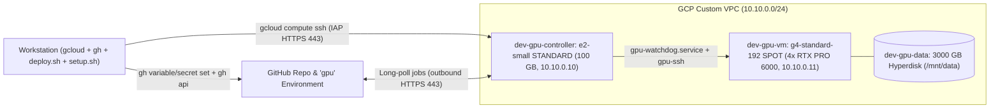

# `development/` — Cloud & On-Prem GPU Development Workflow

End-to-end automation and runbook for provisioning GPU development machines ([`scripts/deploy.sh`](./scripts/deploy.sh)), syncing GitHub Actions variables/secrets + registering the persistent self-hosted runner from a single local `.env` file ([`scripts/setup.sh`](./scripts/setup.sh)), and deploying the GPU Podman inference & harness stack ([`scripts/deploy_gpu_stack.sh`](./scripts/deploy_gpu_stack.sh)) across **GCP**, **Azure**, and **on-premises** targets.

---

## Directory Layout

```text
development/
├── README.md                         # Complete step-by-step workflow & operations guide
├── .env.example                      # Template for gitignored `development/.env` (synced to GitHub via `gh` by setup.sh)
├── gpu-dev-machine/                  # Podman + podman-compose stack (Ray Serve DeepSeek-V4.1-Flash, LiteLLM, DeepSeek Harness, reverse tunnels)
│   ├── compose.yml                   # Stack definition; all model, TP, KV-cache & CPU-offload parameters live directly here
│   ├── .env.example                  # Runtime .env template written on the GPU VM (mode 0600) by deploy_gpu_stack.sh
│   ├── ray-server/                   # Ray Serve + vLLM engine serving full unquantized DeepSeek-V4.1-Flash
│   ├── litellm/                      # LiteLLM OpenAI-compatible proxy (:4000) backed by ray-server (:8000)
│   ├── deepseek-harness/             # DeepSeek Harness web UI (:3080 via socat -> 127.0.0.1:3081) pointed at LiteLLM
│   └── reverse-tunnel/               # Optional autossh reverse-SSH tunnel containers for LiteLLM & DeepSeek Harness
├── infra/
│   ├── gcp/                          # GCP Terraform: always-on Controller/Runner + Spot GPU VM + 3 TB Hyperdisk
│   ├── azure/                        # (Planned) Azure GPU VM Terraform
│   └── on-prem/                      # (Planned) On-prem GPU host configuration
└── scripts/
    ├── deploy.sh                     # Creates/manages the GPU machine infrastructure (--provider=<gcp|azure|on-prem>)
    ├── setup.sh                      # Syncs `development/.env` to GitHub via `gh` & registers/manages the runner on the machine
    └── deploy_gpu_stack.sh           # Syncs & deploys development/gpu-dev-machine via podman-compose (run by CI or locally)
```

---

## Architecture (`--provider=gcp`)



| Component | Default Spec | Lifecycle & Role |
| :--- | :--- | :--- |
| **Controller / Runner VM** (`dev-gpu-controller`) | `e2-small` (`STANDARD`), Ubuntu 24.04, `100 GB` `pd-balanced`, `10.10.0.10` | Runs 24/7. Hosts `gpu-watchdog.service` (checks every 30s and automatically starts `dev-gpu-vm` whenever it is `TERMINATED`/`STOPPED`), plus the persistent GitHub Actions self-hosted runner (`github-runner` user + `/opt/actions-runner`). |
| **Development GPU VM** (`dev-gpu-vm`) | `g4-standard-192` (`SPOT`), 4× NVIDIA RTX PRO 6000, 192 vCPUs, 720 GB RAM, `10.10.0.11` | Preemptible (`instance_termination_action = "STOP"`). Retains boot disk, persistent Hyperdisk, and internal IP across preemptions; runs the `gpu-dev-machine` Podman stack. |
| **Persistent Data Volume** (`dev-gpu-data`) | `3000 GB` `hyperdisk-balanced` | Formatted once (`ext4`) and auto-mounted at `/mnt/data` on every boot; persists Hugging Face weights (`/mnt/data/huggingface`), DeepSeek Harness state (`/mnt/data/deepseek-harness`), and stack files (`/mnt/data/stacks/gpu-dev-machine`). |
| **IAM & Firewall** | Dedicated SAs (`dev-gpu-ctrl`, `dev-gpu-vm-sa`); **Public Ingress Disabled** | `dev-gpu-ctrl` has `compute.instanceAdmin.v1` and `compute.osAdminLogin` **only** on `dev-gpu-vm`. Direct public internet ingress is disabled; SSH tunnels over HTTPS via GCP IAP (`35.235.240.0/20`). |

---

## Step-by-Step Workflow

### Step 1 — Authenticate `gcloud` & `gh` CLI

No service-account JSON keys, cloud credentials, or hardcoded GCP project IDs are stored in the repository or in GitHub. Everything runs from your logged-in workstation CLIs:

```bash
# 1. Authenticate gcloud and select the target GCP project
gcloud auth login
gcloud config set project <YOUR_GCP_PROJECT_ID>

# Verify active account & project
gcloud config get-value account
gcloud config get-value project

# If using a corporate *@google.com account (CBA/mTLS-bound access tokens),
# also log in with Application Default Credentials once — deploy.sh detects
# *@google.com automatically and routes Terraform through ADC:
gcloud auth application-default login

# 2. Authenticate GitHub CLI (`setup.sh` uses `gh` to sync secrets/vars & mint runner tokens)
gh auth login
gh auth status
```

---

### Step 2 — Preview Machine Deployment (`deploy.sh --dry-run`)

Always run `--dry-run` first to verify the resolved `gcloud` account, credential mode (`gcloud` token vs. ADC), active GCP project, OS Login key mode (`false` by default), target region (`europe-west4` by default), and Terraform commands without mutating state:

```bash
./development/scripts/deploy.sh --provider=gcp --dry-run
./development/scripts/deploy.sh --provider=gcp --cycle-regions --loop=5 --dry-run
```

---

### Step 3 — Provision the GPU Machine (`deploy.sh`)

Run [`deploy.sh`](./scripts/deploy.sh) to provision the persistent 3 TB Hyperdisk, Spot GPU VM, and always-on Controller/Runner VM:

```bash
# Deploy in the default region (europe-west4, trying its GPU zones a, b, c automatically)
./development/scripts/deploy.sh --provider=gcp

# Cycle across all GPU-capable regions/zones until live Spot capacity is found
./development/scripts/deploy.sh --provider=gcp --cycle-regions

# Retry every 5 minutes until live Spot GPU capacity is allocated (also accepts `loop=5` or `--loop 5`)
./development/scripts/deploy.sh --provider=gcp --loop=5

# Combine region cycling + 5-minute retry loop until a live GPU VM comes up
./development/scripts/deploy.sh --provider=gcp --cycle-regions --loop=5

# Or cycle through a specific priority list of regions
./development/scripts/deploy.sh --provider=gcp --regions=europe-west4,europe-west2,europe-west1,us-central1,us-east4 --loop=5
```

**What `deploy.sh --provider=gcp` handles automatically:**
1. **Smart Credential Selection (`--adc` / `--gcloud-token`):** Uses a fresh `GOOGLE_OAUTH_ACCESS_TOKEN` from `gcloud auth print-access-token` for standard accounts, and automatically switches to Application Default Credentials (`~/.config/gcloud/application_default_credentials.json`) when logged in as `*@google.com` so CBA/mTLS-bound CLI tokens never trigger `401 ACCESS_TOKEN_TYPE_UNSUPPORTED` on `iam.googleapis.com`.
2. **Native `gcloud` SSH Keys by Default (`--no-register-oslogin-key`):** Sets `register_oslogin_ssh_key = false` by default so Terraform does **not** call `oslogin.googleapis.com/ImportSshPublicKey`—`gcloud compute ssh --tunnel-through-iap` manages its own OS Login key natively. Pass `--register-oslogin-key` only if you explicitly want Terraform to import a generated key and export `ssh-key` / `ssh-key.pub`.
3. **API Enablement & Per-Project Workspace:** Enables `compute.googleapis.com`, `iap.googleapis.com`, `oslogin.googleapis.com`, and `iam.googleapis.com` with public internet ingress disabled (`enable_public_ingress = false`), runs `terraform init`, and selects/creates a Terraform workspace named after your active GCP project (`development/infra/gcp/terraform.tfstate.d/<project_id>/`).
4. **Orphan Cleanup & Spot-First Probing:** Before applying in a candidate zone/region, cleans up any untracked GCP orphans left by interrupted runs (`dev-gpu-controller`, `dev-gpu-vm`, internal IPs) to prevent `400 resourceInUseByAnotherResource` on `dev-gpu-subnet`. It then targets `-target=google_compute_instance.gpu_vm` first to verify live Spot GPU stock before creating `dev-gpu-controller` and IAM bindings:
   - **Without `--loop`:** If every candidate zone returns `ZONE_RESOURCE_POOL_EXHAUSTED`, stages `dev-gpu-vm` as `TERMINATED` and brings up `dev-gpu-controller` so `gpu-watchdog.service` automatically starts `dev-gpu-vm` the moment Spot capacity returns.
   - **With `--loop=<minutes>`:** Defaults to `--no-stage-terminated` and retries every `<minutes>` minutes until a **live `RUNNING`** Spot GPU VM is allocated (pass `--stage-terminated` if you prefer staging early).
5. **Controller Pre-Bootstrap (`controller_startup_script`):** Configures fixed SSH host keys, enables `gpu-watchdog.service`, creates `github-runner` with `/home/github-runner/.ssh/gpu_ed25519`, installs all runner OS/.NET packages, and unpacks the latest `actions-runner-linux-x64` release into `/opt/actions-runner`.

---

### Step 4 — Connect & Manage the GPU Machine

#### From Your Workstation (via `gcloud` IAP)
Public internet ingress is disabled on GCP; `deploy.sh` prints the exact `gcloud compute ssh --tunnel-through-iap` commands at the end of deployment:

```bash
# Connect to the always-on Controller/Runner VM via IAP
eval "$(terraform -chdir=development/infra/gcp output -raw controller_ssh_command)"

# Connect directly to the Spot GPU VM via IAP
eval "$(terraform -chdir=development/infra/gcp output -raw gpu_ssh_command)"

# Optional: forward LiteLLM (:4000) and DeepSeek Harness (:3080) directly to your laptop over IAP
gcloud compute ssh dev-gpu-vm \
  --project="$(gcloud config get-value project)" \
  --zone="$(terraform -chdir=development/infra/gcp output -raw gpu_zone)" \
  --tunnel-through-iap \
  -- -N -L 4000:127.0.0.1:4000 -L 3080:127.0.0.1:3080
```

#### Inside `dev-gpu-controller` (Watchdog & GPU Helpers)
Every user on `dev-gpu-controller` (`dev`, OS Login users, and `github-runner`) has pre-configured passwordless SSH to `dev-gpu-vm` (`10.10.0.11`):

```bash
ssh gpu                       # Interactive shell on dev-gpu-vm (10.10.0.11)
gpu-ssh 'nvidia-smi'          # Run a single command on dev-gpu-vm
gpu-wait-ssh 600              # Block up to 600s until GPU VM SSH is ready (e.g., during Spot restart)
rsync -az ./ gpu:/mnt/data/   # Sync datasets/code to the persistent 3 TB Hyperdisk

gpu-status                    # Check GPU VM state + gpu-watchdog.service logs
gpu-pause                     # Pause automatic Spot restarts (writes /etc/gpu-watchdog.paused)
gpu-resume                    # Resume automatic Spot restarts (removes /etc/gpu-watchdog.paused & triggers start)
```

---

### Step 5 — Configure `development/.env`, Sync GitHub via `gh`, & Register the Runner (`setup.sh`)

[`setup.sh`](./scripts/setup.sh) reads your gitignored `development/.env` file, configures all GitHub Repository & `gpu` Environment variables and secrets via `gh`, mints a runner registration token via `gh api`, and installs/starts the persistent `systemd` GitHub Actions runner on `dev-gpu-controller`.

#### 5.1 Lock Down Public PRs First (Before Attaching a Self-Hosted Runner)

If the target repository is **public**, lock down Pull Requests in GitHub before attaching the runner so external forks can never execute `runs-on: self-hosted`:

1. **Disable or Restrict Public PRs:**
   - **Settings → General → Features → Pull requests** → either **uncheck Pull requests** completely or **restrict pull request creation to collaborators only**.
2. **Fork Workflow Approval Gate (if PRs stay enabled):**
   - **Settings → Actions → General → Fork pull request workflows from outside collaborators** → select **"Require approval for all external contributors"**.
3. **Protected `gpu` Environment Gate:**
   - **Settings → Environments → `gpu`** → restrict **Deployment branches** to `Selected branches: main` and add yourself under **Required reviewers** (note: `setup.sh` creates the `gpu` environment automatically if missing, without overwriting protection rules you set here).
4. **Workflow YAML (`on:` triggers):**
   - Workflows using `runs-on: self-hosted` (such as [`.github/workflows/deploy-gpu-machine.yml`](../.github/workflows/deploy-gpu-machine.yml)) must trigger only on `workflow_dispatch` or `push: branches: [main]`—never `pull_request` or `pull_request_target`.

#### 5.2 Create & Fill In `development/.env`

Copy [`.env.example`](./.env.example) to `development/.env` (gitignored and enforced `chmod 600`):

```bash
cp -n development/.env.example development/.env
chmod 600 development/.env
```

All supported keys in `development/.env`:

| Key in `development/.env` | Default in `.env.example` | Synced Where by `setup.sh` | Purpose |
| :--- | :--- | :--- | :--- |
| **`GITHUB_REPO`** | `vitorecomp/personal-infra` | Local `gh --repo` + runner URL | Target `owner/repo` for variables, secrets, and runner registration. |
| **`GITHUB_ENV`** | `gpu` | Local `gh --env` | GitHub Environment holding GPU stack secrets and variables. |
| **`GH_TOKEN`** | *(empty)* | Local `gh` auth | Optional token override when `gh auth login` is not already active (also falls back to root `.env` `GH_TOKEN`/`GITHUB_TOKEN`). |
| **`GPU_RUNNER`** | `gcp-gpu` | **Repo Variable** `GPU_RUNNER` + runner label | Selects which runner pool runs `deploy-gpu-machine.yml` (`gcp-gpu`, `azure-gpu`, `on-prem-gpu`). |
| **`GPU_RUNNER_LABELS`** | *(empty)* | **Repo Variable** `GPU_RUNNER_LABELS` *(if set)* | Optional full JSON array override for `runs-on:` (e.g. `["self-hosted","linux","x64","gcp-gpu"]`). |
| **`RUNNER_TOKEN`** / **`RUNNER_PAT`** | *(empty)* | Runner registration only | Leave empty—`setup.sh` automatically mints short-lived registration/removal tokens via `gh api`. |
| **`LITELLM_MASTER_KEY`** | `__generate__` | **`gpu` Secret** `LITELLM_MASTER_KEY` | Master Bearer key for `litellm` and `deepseek-harness`. When left as `__generate__` (or empty), `setup.sh` generates a cryptographically random `sk-...` key once, **saves it back into `development/.env` (`0600`)**, and uploads it to GitHub Secrets. |
| **`HF_TOKEN`** | *(empty)* | **`gpu` Secret** `HF_TOKEN` *(if set)* | Optional Hugging Face read token to avoid rate limits pulling `deepseek-ai/DeepSeek-V4.1-Flash`. |
| **`ENABLE_REVERSE_TUNNELS`** | `false` | **`gpu` Variable** `ENABLE_REVERSE_TUNNELS` | `true` starts `litellm-tunnel` + `deepseek-harness-tunnel`; `false` starts only `ray-server`, `litellm`, and `deepseek-harness`. |
| **`TUNNEL_SSH_HOST`** | *(empty)* | **`gpu` Variable** `TUNNEL_SSH_HOST` | Bastion/workstation hostname or IP receiving the reverse SSH tunnels (required when `ENABLE_REVERSE_TUNNELS=true`). |
| **`TUNNEL_SSH_PORT`** | `22` | **`gpu` Variable** `TUNNEL_SSH_PORT` | SSH port on `TUNNEL_SSH_HOST`. |
| **`TUNNEL_SSH_USER`** | *(empty)* | **`gpu` Variable** `TUNNEL_SSH_USER` | SSH username on `TUNNEL_SSH_HOST` (required when `ENABLE_REVERSE_TUNNELS=true`). |
| **`TUNNEL_SSH_KEY_FILE`** | *(empty)* | **`gpu` Secret** `TUNNEL_SSH_PRIVATE_KEY` | **Local workstation path** (e.g. `~/.ssh/gpu_tunnel_ed25519`) whose file contents `setup.sh` uploads as GitHub Secret `TUNNEL_SSH_PRIVATE_KEY`. |
| **`TUNNEL_KNOWN_HOSTS`** | *(empty)* | **`gpu` Variable** `TUNNEL_KNOWN_HOSTS` | Pinned `ssh-keyscan` line(s) **or** a local file path (if the value points to an existing local file, `setup.sh` reads and uploads its contents). |
| **`TUNNEL_BIND_ADDRESS`** | `127.0.0.1` | **`gpu` Variable** `TUNNEL_BIND_ADDRESS` | Address bound on `TUNNEL_SSH_HOST` (`127.0.0.1` or `0.0.0.0`). |
| **`REMOTE_LITELLM_PORT`** | `4000` | **`gpu` Variable** `REMOTE_LITELLM_PORT` | Remote port opened on `TUNNEL_SSH_HOST` forwarding to `litellm:4000`. |
| **`REMOTE_HARNESS_PORT`** | `3080` | **`gpu` Variable** `REMOTE_HARNESS_PORT` | Remote port opened on `TUNNEL_SSH_HOST` forwarding to `deepseek-harness:3080`. |
| **`LITELLM_TUNNEL_SSH_*`** / **`HARNESS_TUNNEL_SSH_*`** | *(empty)* | **`gpu` Variables** *(if set)* | Optional per-tunnel `_HOST`, `_PORT`, `_USER` overrides (inherit `TUNNEL_SSH_*` when empty). |
| **`GPU_TARGET_MODE`** | `auto` | **`gpu` Variable** `GPU_TARGET_MODE` | Runner-to-GPU execution mode: `auto` (`gpu-ssh` on GCP controller), `controller-ssh`, `ssh`, or `local`. |
| **`GPU_SSH_HOST`** / **`GPU_SSH_KEY_FILE`** / **`GPU_SSH_KNOWN_HOSTS`** | *(empty)* | **`gpu` Vars & Secret** `GPU_SSH_PRIVATE_KEY` | Non-GCP SSH target and local private key file path when `GPU_TARGET_MODE=ssh`. |
| **`TRIGGER_DEPLOY`** | `false` | Post-setup `gh workflow run` | Set `true` (or pass `--trigger-deploy`) to immediately dispatch `deploy-gpu-machine.yml` after setup finishes. |

#### 5.3 Run `setup.sh`

```bash
# 1. Preview all `gh` variable/secret commands and remote VM steps (no mutations)
./development/scripts/setup.sh --provider=gcp --dry-run

# 2. Sync `development/.env` -> GitHub via `gh`, register & start the runner on dev-gpu-controller
./development/scripts/setup.sh --provider=gcp

# 3. Same, and immediately dispatch `.github/workflows/deploy-gpu-machine.yml` at the end
./development/scripts/setup.sh --provider=gcp --trigger-deploy

# Optional: update GitHub variables/secrets from `development/.env` only (skip VM SSH)
./development/scripts/setup.sh --provider=gcp --sync-github-only

# Optional: re-configure the VM runner only (skip `gh` variable/secret sync)
./development/scripts/setup.sh --provider=gcp --skip-github-sync

# Check the runner systemd service status anytime
./development/scripts/setup.sh --provider=gcp --status
```

**What `setup.sh` executes under the hood:**
1. Safely parses `development/.env` (enforcing `0600` permissions) without `source`-ing arbitrary shell code and **never echoes secret values** to stdout/stderr.
2. Ensures the `gpu` GitHub Environment exists via `gh api`, auto-generates & persists `LITELLM_MASTER_KEY` in `development/.env` if set to `__generate__`, and runs `gh variable set` + `gh secret set` for all configured repository/environment items.
3. Resolves `dev-gpu-controller`'s GCP project and zone automatically from the active Terraform workspace (falling back to `gcloud compute instances list`).
4. Mints a short-lived runner registration token via `gh api -X POST repos/<owner>/<repo>/actions/runners/registration-token`.
5. Streams the configuration script over `gcloud compute ssh --tunnel-through-iap` stdin so tokens never appear in remote `ps aux` or shell history, installs/starts the `systemd` runner unit as `github-runner` in `/opt/actions-runner` with labels `self-hosted,linux,x64,<GPU_RUNNER>`, and optionally triggers `gh workflow run deploy-gpu-machine.yml`.

#### 5.4 Podman Stack Deployed on `dev-gpu-vm` ([`development/gpu-dev-machine/`](./gpu-dev-machine))

When [`.github/workflows/deploy-gpu-machine.yml`](../.github/workflows/deploy-gpu-machine.yml) runs on `dev-gpu-controller` (triggered by pushes to `main` touching `development/gpu-dev-machine/**` or via `workflow_dispatch`), [`deploy_gpu_stack.sh`](./scripts/deploy_gpu_stack.sh):
1. Waits up to 600s for `dev-gpu-vm` SSH (`gpu-wait-ssh 600`) so deploys cleanly survive Spot preemptions.
2. Idempotently bootstraps Podman, `podman-compose`, `nvidia-container-toolkit` CDI (`/etc/cdi/nvidia.yaml`), and `/mnt/data/containers` storage on `dev-gpu-vm` if missing.
3. Syncs `development/gpu-dev-machine/` to `/mnt/data/stacks/gpu-dev-machine`, streams `.env` (`0600`) and reverse-tunnel SSH material over stdin without logging values, and runs `podman-compose -f compose.yml up -d --build`.

| Service in [`compose.yml`](./gpu-dev-machine/compose.yml) | GPU VM Port | Persistent Storage on `/mnt/data` | Role & Configuration |
| :--- | :--- | :--- | :--- |
| **`ray-server`** | `127.0.0.1:8000` (API), `127.0.0.1:8265` (Ray Dashboard) | `/mnt/data/huggingface` | Serves full unquantized `deepseek-ai/DeepSeek-V4.1-Flash` (`TENSOR_PARALLEL_SIZE=4`, `CPU_OFFLOAD_GB=48`, `ENGRAM_CPU_OFFLOAD=true`, `KV_CACHE_DTYPE=fp8`, `MAX_MODEL_LEN=65536`). **All model & offload parameters are version-controlled directly in [`compose.yml`](./gpu-dev-machine/compose.yml)**—not pipeline variables. |
| **`litellm`** | `127.0.0.1:4000` | — | OpenAI-compatible gateway authenticated with `LITELLM_MASTER_KEY`, routing model aliases to `http://ray-server:8000/v1`. |
| **`deepseek-harness`** | `127.0.0.1:3080` | `/mnt/data/deepseek-harness/{dsh-home,workspace}` | Runs `@deepseek-ai/dsh` web UI (`127.0.0.1:3081` forwarded from container `0.0.0.0:3080` via `socat`), pre-wired to `http://litellm:4000/v1` with `LITELLM_MASTER_KEY`. |
| **`litellm-tunnel`** *(optional)* | Outbound SSH | `/mnt/data/reverse-tunnel` | Started only when `ENABLE_REVERSE_TUNNELS=true`; `autossh` reverse-forwards `TUNNEL_SSH_HOST:REMOTE_LITELLM_PORT` → `litellm:4000`. |
| **`deepseek-harness-tunnel`** *(optional)* | Outbound SSH | `/mnt/data/reverse-tunnel` | Started only when `ENABLE_REVERSE_TUNNELS=true`; `autossh` reverse-forwards `TUNNEL_SSH_HOST:REMOTE_HARNESS_PORT` → `deepseek-harness:3080`. |

---

## GitHub Variables & Secrets Reference

All items below are populated automatically from `development/.env` when you run `./development/scripts/setup.sh --provider=gcp`:

### 1. Repository Variables (`Settings → Secrets and variables → Actions → Variables`)

> **Why Repository-level?** GitHub Actions evaluates `runs-on:` before loading Environment variables, so runner pool selection lives in Repository Variables.

| Variable | Required | Default / Example | Description |
| :--- | :--- | :--- | :--- |
| **`GPU_RUNNER`** | **Recommended** | `gcp-gpu` *(or `azure-gpu`, `on-prem-gpu`)* | Controls which self-hosted runner pool executes `deploy-gpu-machine.yml` (`["self-hosted","linux","x64","<GPU_RUNNER>"]`). |
| **`GPU_RUNNER_LABELS`** | Optional | `["self-hosted","linux","x64","gcp-gpu"]` | Full JSON label array override for `runs-on:` if custom label combinations are needed instead of `GPU_RUNNER`. |

### 2. `gpu` Environment Secrets (`Settings → Environments → gpu → Environment secrets`)

| Secret | Required | Description |
| :--- | :--- | :--- |
| **`LITELLM_MASTER_KEY`** | **Yes** | Master Bearer key securing `litellm` and injected into `deepseek-harness` (auto-generated once by `setup.sh` when `LITELLM_MASTER_KEY=__generate__`). |
| **`TUNNEL_SSH_PRIVATE_KEY`** | When tunnels enabled | OpenSSH private key uploaded from `TUNNEL_SSH_KEY_FILE` in `development/.env`, used by `litellm-tunnel` and `deepseek-harness-tunnel`. |
| **`HF_TOKEN`** | Optional | Hugging Face read token to avoid rate limits when downloading `deepseek-ai/DeepSeek-V4.1-Flash`. |
| **`GPU_SSH_PRIVATE_KEY`** | Optional (non-GCP) | SSH private key uploaded from `GPU_SSH_KEY_FILE` when `GPU_TARGET_MODE=ssh` targets an external `GPU_SSH_HOST`. |

### 3. `gpu` Environment Variables (`Settings → Environments → gpu → Environment variables`)

> **Note:** Model, tensor-parallelism, and CPU-offload settings are intentionally **not** pipeline variables—edit [`development/gpu-dev-machine/compose.yml`](./gpu-dev-machine/compose.yml) to change them.

| Variable | Required | Default | Description |
| :--- | :--- | :--- | :--- |
| **`ENABLE_REVERSE_TUNNELS`** | Optional | `false` *(or `true` if `TUNNEL_SSH_HOST` set)* | `true` starts `litellm-tunnel` + `deepseek-harness-tunnel`; `false` starts only `ray-server`, `litellm`, and `deepseek-harness`. |
| **`TUNNEL_SSH_HOST`** | When tunnels enabled | — | Remote bastion/workstation hostname or IP receiving the reverse-forwarded ports. |
| **`TUNNEL_SSH_USER`** | When tunnels enabled | — | SSH username on `TUNNEL_SSH_HOST`. |
| **`TUNNEL_SSH_PORT`** | Optional | `22` | SSH port on `TUNNEL_SSH_HOST`. |
| **`TUNNEL_KNOWN_HOSTS`** | Optional | *(accept-new TOFU)* | Pinned `ssh-keyscan` line(s) for `TUNNEL_SSH_HOST` (enforces `StrictHostKeyChecking=yes`). |
| **`TUNNEL_BIND_ADDRESS`** | Optional | `127.0.0.1` | Interface bound on `TUNNEL_SSH_HOST` (`127.0.0.1` or `0.0.0.0`). |
| **`REMOTE_LITELLM_PORT`** | Optional | `4000` | Port opened on `TUNNEL_SSH_HOST` forwarding to `litellm:4000`. |
| **`REMOTE_HARNESS_PORT`** | Optional | `3080` | Port opened on `TUNNEL_SSH_HOST` forwarding to `deepseek-harness:3080`. |
| **`LITELLM_TUNNEL_SSH_HOST`** / `_PORT` / `_USER` | Optional | Inherits `TUNNEL_SSH_*` | Optional per-tunnel destination override for `litellm-tunnel`. |
| **`HARNESS_TUNNEL_SSH_HOST`** / `_PORT` / `_USER` | Optional | Inherits `TUNNEL_SSH_*` | Optional per-tunnel destination override for `deepseek-harness-tunnel`. |
| **`GPU_TARGET_MODE`** | Optional | `auto` | `auto` (`gpu-ssh` on GCP controller, `GPU_SSH_HOST` if set, else `local`), `controller-ssh`, `ssh`, or `local`. |
| **`GPU_SSH_HOST`** / **`GPU_SSH_KNOWN_HOSTS`** | Optional | — | Target `user@host` and `known_hosts` when `GPU_TARGET_MODE=ssh`. |

---

## Step 6 — Day-2 Operations (Pause, Rotate Secrets, Update, Destroy)

### Pause GPU Billing While Preserving `/mnt/data` and the Runner
When you want zero GPU compute spend while keeping `dev-gpu-controller`, the GitHub runner, and the `3000 GB` `/mnt/data` Hyperdisk intact:

```bash
# 1. On dev-gpu-controller: pause the 30s auto-restart watchdog
gpu-pause

# 2. Stop the GPU VM (from workstation or controller)
gcloud compute instances stop dev-gpu-vm \
  --project="$(gcloud config get-value project)" \
  --zone="$(terraform -chdir=development/infra/gcp output -raw gpu_zone)"

# Later, resume automatic GPU VM startup:
gpu-resume
```

### Update Secrets / Tunnel Settings Without Touching the Runner
```bash
# Edit development/.env, sync to GitHub via `gh`, and trigger a redeploy:
./development/scripts/setup.sh --provider=gcp --sync-github-only --trigger-deploy
```

### Plan / Update Infrastructure Changes
```bash
./development/scripts/deploy.sh --provider=gcp --plan
./development/scripts/deploy.sh --provider=gcp --apply
```

### Cleanly Remove the Runner & Full Teardown (`--destroy`)
> **Warning:** `deploy.sh --destroy` deletes both VMs and the `dev-gpu-data` Hyperdisk volume (`3000 GB`). Back up `/mnt/data` before destroying.

```bash
# 1. Unregister & uninstall the runner (`setup.sh` auto-mints the removal token via `gh api`)
./development/scripts/setup.sh --provider=gcp --remove

# 2. Destroy all GCP GPU resources in the active project
./development/scripts/deploy.sh --provider=gcp --destroy
```

---

## CLI Reference

### 1. [`deploy.sh`](./scripts/deploy.sh) — Machine Creation & Infrastructure

| Flag | Description |
| :--- | :--- |
| `--provider=<gcp\|azure\|on-prem>` | **(Required)** Target infrastructure folder under `development/infra/<provider>`. |
| `--dry-run` | Print resolved credentials, active project, OS Login key mode, and Terraform commands without executing. |
| `--apply` | Initialize and apply Terraform (default action). |
| `--loop=<minutes>` | Retry `apply` every `<minutes>` minutes until live capacity succeeds (also accepts `--loop <min>` or `loop=<min>`). |
| `--plan` | Initialize and run `terraform plan` without applying. |
| `--validate` | Run `terraform init -backend=false` and `terraform validate`. |
| `--destroy` | Destroy Terraform-managed resources for the selected provider. |
| `--project=<id>` | Override active `gcloud config` project (`gcp` only). |
| `--no-register-oslogin-key` | **(Default)** Skip importing a Terraform SSH key into Cloud OS Login (`gcloud compute ssh` manages keys natively). |
| `--register-oslogin-key` | Import Terraform's generated SSH public key into Cloud OS Login and export `ssh-key` / `ssh-key.pub`. |
| `--adc` / `--gcloud-token` | Force ADC or `gcloud` CLI token (auto-selects ADC for `*@google.com` CBA accounts and `gcloud` token otherwise). |
| `--region=<region>` | Target cloud region override (default: `europe-west4`). |
| `--zone=<zone>` | Target cloud zone override (default: `europe-west4-a`, or all GPU zones in region on apply). |
| `--cycle-regions` | Cycle across all GPU-capable regions/zones until live Spot capacity is allocated (`gcp`). |
| `--regions=r1,r2,...` | Cycle through a specific comma-separated list of regions in order (`gcp`). |
| `--machine-type=<type>` | Override GPU VM machine type (default: `g4-standard-192`). |
| `--name-prefix=<prefix>` | Override resource prefix (default: `dev-gpu`). |
| `--force-move` | Allow moving region/zone even if an instance already exists in Terraform state. |
| `--no-stage-terminated` | Exit 1 instead of staging a `TERMINATED` Spot VM when out of stock (default when `--loop` is set). |
| `--stage-terminated` | Allow staging a `TERMINATED` Spot VM for `gpu-watchdog` even when `--loop` is set. |
| `--auto-approve` / `--no-auto-approve` | Control `-auto-approve` on `terraform apply` / `destroy` (default: `--auto-approve`). |

### 2. [`setup.sh`](./scripts/setup.sh) — `development/.env` GitHub Sync & Runner Setup

| Flag | Description |
| :--- | :--- |
| `--provider=<gcp\|azure\|on-prem>` | Target provider (`gcp` connects via `gcloud compute ssh --tunnel-through-iap`; others via `ssh`). |
| `--env-file=<path>` | Path to `.env` configuration file (default: `development/.env`). |
| `--repo=<owner/repo>` | GitHub repository override (default: `GITHUB_REPO` in `.env`, else `vitorecomp/personal-infra`). |
| `--github-env=<name>` | GitHub Environment name for stack secrets & variables (default: `gpu`). |
| `--sync-github-only` | Sync `development/.env` variables/secrets to GitHub via `gh` and exit (skip VM SSH). |
| `--skip-github-sync` | Skip `gh variable/secret set` and only configure the runner on the target machine. |
| `--trigger-deploy` | Run `gh workflow run deploy-gpu-machine.yml` after setup finishes (or set `TRIGGER_DEPLOY=true` in `.env`). |
| `--status` | Check the runner `systemd` service status on the target machine. |
| `--remove` | Stop/uninstall the `systemd` unit and unregister the runner (auto-mints removal token via `gh api`). |
| `--dry-run` | Print resolved `gh` commands (secrets redacted) and remote runner steps without mutating GitHub or SSHing. |
| `--project=<id>` / `--zone=<zone>` / `--instance=<name>` | GCP controller target overrides (auto-resolved from Terraform workspace / `gcloud` when omitted). |
| `--host=<user@ip>` / `--ssh-key=<path>` / `--known-hosts=<path>` | Explicit SSH target & key overrides (for `azure`, `on-prem`, or custom hosts). |
| `--token=<token>` / `--pat=<pat>` | Optional explicit runner token or Fine-Grained PAT (auto-minted via `gh api` when omitted). |
| `--name=<name>` | Runner name in GitHub (default: `<provider>-gpu-controller`). |
| `--labels=l1,l2,...` | Comma-separated runner labels (default: `self-hosted,linux,x64,<GPU_RUNNER>`). |
| `--runner-user=<user>` / `--runner-dir=<dir>` / `--work-dir=<dir>` | Remote OS user (`github-runner`), install path (`/opt/actions-runner`), and work directory (`_work`). |

### 3. [`deploy_gpu_stack.sh`](./scripts/deploy_gpu_stack.sh) — GPU Podman Stack Deployer

| Flag | Description |
| :--- | :--- |
| `--target-mode=<auto\|controller-ssh\|ssh\|local>` | Execution mode (default: `auto` → uses `gpu-ssh` on GCP controller, `GPU_SSH_HOST` if set, else `local`). |
| `--ssh-host=<user@host>` | Target SSH host when `--target-mode=ssh` (or env `GPU_SSH_HOST`). |
| `--stack-dir=<path>` | Destination stack directory on the GPU VM (default: `/mnt/data/stacks/gpu-dev-machine`). |
| `--wait-timeout=<seconds>` | Max seconds to wait for Spot GPU VM SSH in `controller-ssh` mode (default: `600`). |
| `--dry-run` | Print resolved target mode, synced env key names (never values), and compose commands without mutating state. |
