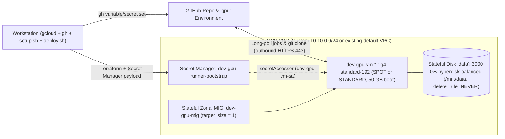

# `development/` — Cloud & On-Prem GPU Development Workflow

End-to-end automation and runbook for syncing GitHub Actions variables/secrets and managing runners ([`scripts/setup.sh`](./scripts/setup.sh)), provisioning GPU development machines ([`scripts/deploy.sh`](./scripts/deploy.sh)), and deploying the GPU Podman inference & harness stack ([`scripts/deploy_gpu_stack.sh`](./scripts/deploy_gpu_stack.sh)) across **GCP**, **Azure**, and **on-premises** targets.

---

## Directory Layout

```text
development/
├── README.md                         # Complete step-by-step workflow & operations guide
├── .env.example                      # Template for gitignored `development/.env` (synced to GitHub via `gh` by setup.sh)
├── gpu-dev-machine/                  # Podman + podman-compose stack (vLLM DeepSeek-V4.1-Flash, LiteLLM, DeepSeek Harness, reverse tunnels)
│   ├── compose.yml                   # Stack definition; all model, TP, KV-cache & CPU-offload parameters live directly here
│   ├── .env.example                  # Runtime .env template written on the GPU VM (mode 0600) by deploy_gpu_stack.sh
│   ├── compose.yml → vllm-server     # vLLM OpenAI server (image only) serving full unquantized DeepSeek-V4.1-Flash
│   ├── litellm/                      # LiteLLM OpenAI-compatible proxy (:4000) backed by vllm-server (:8000)
│   ├── deepseek-harness/             # DeepSeek Harness web UI (:3080 via socat -> 127.0.0.1:3081) pointed at LiteLLM
│   └── reverse-tunnel/               # Optional autossh reverse-SSH tunnel containers for LiteLLM & DeepSeek Harness
├── infra/
│   ├── gcp/                          # GCP Terraform: Stateful Zonal MIG (Spot/Standard, custom/default VPC) + Secret Manager runner bootstrap + 3 TB Hyperdisk
│   ├── azure/                        # (Planned) Azure GPU VM Terraform
│   └── on-prem/                      # (Planned) On-prem GPU host configuration
└── scripts/
    ├── setup.sh                      # Syncs `development/.env` to GitHub via `gh` (zero-SSH on GCP; SSH runner setup for azure/on-prem)
    ├── deploy.sh                     # Creates/manages the GPU machine infrastructure (--provider=<gcp|azure|on-prem>)
    └── deploy_gpu_stack.sh           # Syncs & deploys development/gpu-dev-machine via podman-compose (run by CI or locally)
```

---

## Architecture (`--provider=gcp`)

On GCP, `development/` uses a **zero-SSH single-VM Stateful Zonal Managed Instance Group (`dev-gpu-mig`)** with no separate controller VM. All setup and orchestration work over outbound HTTPS (`443`):



| Component | Default Spec | Lifecycle & Role |
| :--- | :--- | :--- |
| **Stateful Zonal MIG** (`dev-gpu-mig`) | `target_size = 1`, `replacement_method = "RECREATE"`, `default_action_on_failure = "REPAIR"`, `force_update_on_repair = "YES"` | Keeps a single GPU instance alive across Spot preemptions and template updates while preserving the attached stateful `data` disk. |
| **GPU VM Template** (`dev-gpu-tpl-*`) | `g4-standard-192` (4× NVIDIA RTX PRO 6000, 192 vCPUs, 720 GB RAM), Ubuntu 24.04, `50 GB` `hyperdisk-balanced` boot disk | Configurable via `--spot` (`SPOT`, `instance_termination_action = "STOP"`, default) or `--no-spot` (`STANDARD` on-demand). On boot, `startup-script` installs NVIDIA drivers, Container Toolkit CDI, Podman, and `actions-runner`, self-registers against GitHub, and auto-resumes any deployed stack. |
| **Stateful Data Disk** (`device_name = "data"`) | `3000 GB` `hyperdisk-balanced` (`delete_rule = "NEVER"`) | Formatted once (`ext4`) and mounted at `/mnt/data` on every boot; persists `/mnt/data/actions-runner` (including `.credentials`), `/mnt/data/containers/storage`, `/mnt/data/huggingface`, `/mnt/data/deepseek-harness`, `/mnt/data/reverse-tunnel`, and `/mnt/data/stacks/gpu-dev-machine`. |
| **Runner Bootstrap Secret** (`dev-gpu-runner-bootstrap`) | GCP Secret Manager (`secretAccessor` for `dev-gpu-vm-sa` only) | Holds JSON (`github_repo`, `runner_name`, `runner_labels`, `runner_token`, `runner_pat`) passed via `TF_VAR_*` by `deploy.sh`. Never exposed in Terraform CLI args or logs. |
| **Networking, IAM & Firewall** | Custom VPC (`10.10.0.0/24`) or `default` VPC (`--use-default-vpc`); `dev-gpu-vm-sa` | Ephemeral external IP on `nic0` by default (`enable_external_ip = true`), or Cloud Router + Cloud NAT when disabled. Outbound HTTPS (`443`) is allowed; direct public ingress is disabled by default (`enable_public_ingress = false`), with optional IAP TCP `22` (`35.235.240.0/20`) for admin debugging only. |

---

## Step-by-Step Workflow

### Step 1 — Authenticate `gcloud` & `gh` CLI

No service-account JSON keys, cloud credentials, or hardcoded GCP project IDs are stored in the repository or in GitHub. Everything runs from your logged-in workstation CLIs:

```bash
# 1. Authenticate gcloud and select the target GCP project
gcloud auth login
gcloud config set project <YOUR_GCP_PROJECT_ID>

# Verify active account & project
gcloud config get-value account
gcloud config get-value project

# If using a corporate *@google.com account (CBA/mTLS-bound access tokens),
# also log in with Application Default Credentials once — deploy.sh detects
# *@google.com automatically and routes Terraform through ADC:
gcloud auth application-default login

# 2. Authenticate GitHub CLI (`setup.sh` and `deploy.sh` use `gh` to sync secrets/vars & mint runner tokens)
gh auth login
gh auth status
```

---

### Step 2 — Lock Down Public PRs, Configure `development/.env`, & Sync GitHub (`setup.sh`)

#### 2.1 Lock Down Public PRs First (Before Attaching a Self-Hosted Runner)

If the target repository is **public**, lock down Pull Requests in GitHub before attaching the runner so external forks can never execute `runs-on: self-hosted`:

1. **Disable or Restrict Public PRs:**
   - **Settings → General → Features → Pull requests** → either **uncheck Pull requests** completely or **restrict pull request creation to collaborators only**.
2. **Fork Workflow Approval Gate (if PRs stay enabled):**
   - **Settings → Actions → General → Fork pull request workflows from outside collaborators** → select **"Require approval for all external contributors"**.
3. **Protected `gpu` Environment Gate:**
   - **Settings → Environments → `gpu`** → restrict **Deployment branches** to `Selected branches: main` and add yourself under **Required reviewers** (`setup.sh` creates the `gpu` environment automatically if missing, without overwriting protection rules you configure).
4. **Workflow YAML (`on:` triggers):**
   - Workflows using `runs-on: self-hosted` (such as [`.github/workflows/deploy-gpu-machine.yml`](../.github/workflows/deploy-gpu-machine.yml)) must trigger only on `workflow_dispatch` or `push: branches: [main]`—never `pull_request` or `pull_request_target`.

#### 2.2 Create & Fill In `development/.env`

Copy [`.env.example`](./.env.example) to `development/.env` (gitignored and enforced `chmod 600`):

```bash
cp -n development/.env.example development/.env
chmod 600 development/.env
```

All supported keys in `development/.env`:

| Key in `development/.env` | Default in `.env.example` | Used / Synced Where | Purpose |
| :--- | :--- | :--- | :--- |
| **`GITHUB_REPO`** | `vitorecomp/personal-infra` | `gh --repo` + Secret Manager payload | Target `owner/repo` for variables, secrets, and runner self-registration. |
| **`GITHUB_ENV`** | `gpu` | `gh --env` | GitHub Environment holding GPU stack secrets and variables. |
| **`GH_TOKEN`** | *(empty)* | Local `gh` auth | Optional token override when `gh auth login` is not active (falls back to root `.env` `GH_TOKEN` / `GITHUB_TOKEN`). |
| **`GPU_RUNNER`** | `gcp-gpu` | **Repo Variable** `GPU_RUNNER` + runner label | Selects which runner pool executes `deploy-gpu-machine.yml` (`gcp-gpu`, `azure-gpu`, `on-prem-gpu`). |
| **`GPU_RUNNER_LABELS`** | `["self-hosted","linux","x64","gcp-gpu"]` | **Repo Variable** `GPU_RUNNER_LABELS` | Full JSON label array synced for `runs-on:`. |
| **`RUNNER_NAME`** / **`RUNNER_LABELS`** | `gcp-gpu-runner` / `self-hosted,linux,x64,gcp-gpu` | Secret Manager + runner config | Self-hosted runner name and comma-separated labels registered by the GPU VM on boot. |
| **`RUNNER_PAT`** | *(empty)* | `TF_VAR_runner_pat` → Secret Manager | Optional repo-scoped Fine-Grained PAT (**Administration: Read & Write**). When empty, `deploy.sh` auto-mints a 1-hour registration token via `gh api` and `/mnt/data/actions-runner/.credentials` persists across Spot recreations. |
| **`PROJECT_ID`** | *(empty)* | `deploy.sh` / `setup.sh --status` | Optional GCP project override (defaults to active `gcloud config get-value project`). |
| **`REGION`** / **`ZONE`** | *(empty)* | `deploy.sh` / `setup.sh --status` | Optional GCP region and zone overrides (defaults to `europe-west4` / `europe-west4-a`, or candidate GPU zones). |
| **`USE_SPOT`** | `true` | GCP Terraform (`use_spot`) | `true` provisions a Spot GPU VM auto-healed by the MIG; `false` provisions a Standard on-demand GPU VM. |
| **`USE_DEFAULT_VPC`** / **`DEFAULT_VPC_NAME`** | `false` / `default` | GCP Terraform (`use_default_vpc`) | Set `true` (or pass `--use-default-vpc`) to attach the MIG to an existing VPC instead of creating `dev-gpu-vpc`. |
| **`ENABLE_INGRESS_FIREWALLS`** | `true` | GCP Terraform (`enable_ingress_firewalls`) | Manage VPC ingress firewall rules in Terraform (set `false` if external org policies manage VPC ingress). |
| **`SSH_PROXY_CIDRS`** | `35.235.240.0/20` | GCP VPC firewall (`allow-iap-ssh`) | Proxy CIDR ranges allowed on TCP `22` for optional admin debugging (defaults to GCP IAP). |
| **`LITELLM_MASTER_KEY`** | `__generate__` | **`gpu` Secret** `LITELLM_MASTER_KEY` | Master Bearer key for `litellm` and `deepseek-harness`. When `__generate__` (or empty), `setup.sh` generates a random `sk-...` key once, **saves it back into `development/.env` (`0600`)**, and uploads it to GitHub Secrets. |
| **`HF_TOKEN`** | *(empty)* | **`gpu` Secret** `HF_TOKEN` *(if set)* | Optional Hugging Face read token to avoid rate limits pulling `deepseek-ai/DeepSeek-V4.1-Flash`. |
| **`ENABLE_REVERSE_TUNNELS`** | `false` | **`gpu` Variable** `ENABLE_REVERSE_TUNNELS` | `true` starts `litellm-tunnel` + `deepseek-harness-tunnel`; `false` starts only `vllm-server`, `litellm`, and `deepseek-harness`. |
| **`TUNNEL_SSH_HOST`** | *(empty)* | **`gpu` Variable** `TUNNEL_SSH_HOST` | Bastion/workstation hostname or IP receiving the reverse SSH tunnels (required when `ENABLE_REVERSE_TUNNELS=true`). |
| **`TUNNEL_SSH_PORT`** / **`TUNNEL_SSH_USER`** | `22` / *(empty)* | **`gpu` Variables** | SSH port and username on `TUNNEL_SSH_HOST`. |
| **`TUNNEL_SSH_KEY_FILE`** | `__generate__` | **`gpu` Secret** `TUNNEL_SSH_PRIVATE_KEY` | When `__generate__`, `setup.sh` creates `~/.ssh/gpu_tunnel_ed25519` (+ `.pub`), saves its path in `development/.env`, and uploads the private key as `TUNNEL_SSH_PRIVATE_KEY`. |
| **`TUNNEL_KNOWN_HOSTS`** | *(empty)* | **`gpu` Variable** `TUNNEL_KNOWN_HOSTS` | Pinned `ssh-keyscan` line(s) **or** a local `known_hosts` file path. |
| **`TUNNEL_BIND_ADDRESS`** | `127.0.0.1` | **`gpu` Variable** `TUNNEL_BIND_ADDRESS` | Address bound on `TUNNEL_SSH_HOST` (`127.0.0.1` or `0.0.0.0`). |
| **`REMOTE_LITELLM_PORT`** / **`REMOTE_HARNESS_PORT`** | `4000` / `3080` | **`gpu` Variables** | Remote ports opened on `TUNNEL_SSH_HOST` forwarding to `litellm:4000` and `deepseek-harness:3080`. |
| **`LITELLM_TUNNEL_SSH_*`** / **`HARNESS_TUNNEL_SSH_*`** | *(empty)* | **`gpu` Variables** *(if set)* | Optional per-tunnel `_HOST`, `_PORT`, `_USER` overrides (inherit `TUNNEL_SSH_*` when empty). |
| **`GPU_TARGET_MODE`** | `local` | **`gpu` Variable** `GPU_TARGET_MODE` | Runner-to-GPU target mode: `local` (default on GCP Stateful MIG since the runner runs directly on the GPU VM), `auto`, or `ssh` (external hosts). |
| **`GPU_SSH_HOST`** / **`GPU_SSH_KEY_FILE`** / **`GPU_SSH_KNOWN_HOSTS`** | *(empty)* | **`gpu` Vars & Secret** `GPU_SSH_PRIVATE_KEY` | Non-GCP SSH target and private key file path when `GPU_TARGET_MODE=ssh`. |
| **`TRIGGER_DEPLOY`** | `false` | Post-setup `gh workflow run` | Set `true` (or pass `--trigger-deploy`) to immediately dispatch `deploy-gpu-machine.yml` after setup finishes. |

#### 2.3 Run `setup.sh --provider=gcp` (Purely Local `gh` Sync, Zero SSH)

On GCP (`--provider=gcp` without `--host`), [`setup.sh`](./scripts/setup.sh) **never opens SSH**—it only syncs `development/.env` to GitHub via `gh`, and manages `--status` / `--remove` via `gh api`:

```bash
# 1. Preview all `gh` variable/secret sync commands (safe, read-only)
./development/scripts/setup.sh --provider=gcp --dry-run

# 2. Generate any `__generate__` secrets locally and sync Repo & `gpu` Environment via `gh`
./development/scripts/setup.sh --provider=gcp

# Check GitHub runner online/offline state & GCP Stateful MIG instances anytime (zero SSH)
./development/scripts/setup.sh --provider=gcp --status
```

> **Note:** SSH runner installation in `setup.sh` is retained for `--provider=azure`, `--provider=on-prem`, or when an explicit `--host=user@ip` is provided (e.g., `./development/scripts/setup.sh --provider=on-prem --host=dev@192.0.2.10`).

---

### Step 3 — Preview & Provision the Stateful MIG (`deploy.sh`)

#### 3.1 Preview (`--dry-run`)

Always run `--dry-run` first to verify your resolved `gcloud` account, credential mode (`gcloud` token vs. ADC), active project, Spot/Standard setting, VPC mode, and Terraform commands:

```bash
./development/scripts/deploy.sh --provider=gcp --dry-run
./development/scripts/deploy.sh --provider=gcp --no-spot --use-default-vpc --dry-run
./development/scripts/deploy.sh --provider=gcp --cycle-regions --loop=5 --dry-run
```

#### 3.2 Provision the Stateful Zonal MIG (`deploy.sh`)

```bash
# Default: Spot GPU VM in the Stateful MIG (custom VPC, tries GPU zones in europe-west4)
./development/scripts/deploy.sh --provider=gcp

# Standard (on-demand) GPU VM attached to the existing 'default' VPC
./development/scripts/deploy.sh --provider=gcp --no-spot --use-default-vpc

# Cycle across all GPU-capable regions every 5 minutes until Spot capacity opens
./development/scripts/deploy.sh --provider=gcp --spot --cycle-regions --loop=5

# Or cycle through a specific priority list of regions
./development/scripts/deploy.sh --provider=gcp --regions=europe-west4,europe-west2,europe-west1,us-central1,us-east4 --loop=5
```

**What `deploy.sh --provider=gcp` handles automatically:**
1. **Smart Credential Selection (`--adc` / `--gcloud-token`):** Uses `GOOGLE_OAUTH_ACCESS_TOKEN` for standard accounts, and automatically switches to Application Default Credentials (`~/.config/gcloud/application_default_credentials.json`) for `*@google.com` CBA accounts.
2. **API Enablement & Per-Project Workspace:** Enables `compute.googleapis.com`, `secretmanager.googleapis.com`, `iap.googleapis.com`, `oslogin.googleapis.com`, and `iam.googleapis.com`, initializes Terraform, and selects/creates workspace `development/infra/gcp/terraform.tfstate.d/<project_id>/`.
3. **Zero-Leak Runner Bootstrap Auth:** Uses `RUNNER_PAT` if set in `development/.env`, or auto-mints a 1-hour GitHub runner registration token via `gh api`, passing it exclusively via `TF_VAR_runner_pat` / `TF_VAR_runner_token` into GCP Secret Manager (`dev-gpu-runner-bootstrap`).
4. **Stateful MIG Provisioning & Zone Cycling:** Applies the Stateful MIG (`dev-gpu-mig`, `target_size = 1`) and polls `gcloud compute instance-groups managed list-instances` for up to 90s (`18 * 5s`) to verify `RUNNING` status. On `QUOTA_EXCEEDED` it skips the region; on `ZONE_RESOURCE_POOL_EXHAUSTED` it destroys and tries the next candidate (or leaves the MIG active on the final candidate when `--stage-terminated` is enabled / `--loop` is not set).
5. **Zero-SSH Self-Registration on Boot (`startup-script`):** Logged to `/var/log/gpu-mig-bootstrap.log` on the GPU VM:
   - Formats `/dev/disk/by-id/google-data` once (`ext4`) and mounts it at `/mnt/data` (`nofail`).
   - Points Podman `graphroot` at `/mnt/data/containers/storage` so container images never fill the 50 GB boot disk.
   - Creates `github-runner` with passwordless sudo and symlinks `/opt/actions-runner -> /mnt/data/actions-runner`.
   - Installs OS packages, NVIDIA driver (`nvidia-smi`), `nvidia-container-toolkit` (`/etc/cdi/nvidia.yaml`), Podman, `podman-compose`, and `actions-runner-linux-x64`.
   - Fetches `dev-gpu-runner-bootstrap` from Secret Manager: reuses preserved `.runner` / `.credentials` on `/mnt/data/actions-runner` if already registered (or registers fresh with `--replace`), installs and starts the `systemd` runner service, and auto-resumes any previously deployed Podman stack in `/mnt/data/stacks/gpu-dev-machine`.

Verify the GPU VM and GitHub runner are online (zero SSH):

```bash
./development/scripts/setup.sh --provider=gcp --status
```

---

### Step 4 — Deploy the Podman Stack & Spot Auto-Recovery

Once `./development/scripts/setup.sh --provider=gcp --status` shows your self-hosted runner (`gcp-gpu-runner`) is **online**:

1. **Deploy via GitHub Actions:** Push a change under `development/gpu-dev-machine/**` to `main`, trigger [`.github/workflows/deploy-gpu-machine.yml`](../.github/workflows/deploy-gpu-machine.yml) manually (`workflow_dispatch`), or run:
   ```bash
   ./development/scripts/setup.sh --provider=gcp --sync-github-only --trigger-deploy
   ```
2. **Direct Local Execution (`GPU_TARGET_MODE=local`):** Because the runner runs directly on the GPU VM in `dev-gpu-mig`, [`deploy_gpu_stack.sh`](./scripts/deploy_gpu_stack.sh) executes locally:
   - Ensures `/mnt/data` directories, Podman storage config, NVIDIA driver, and `/etc/cdi/nvidia.yaml` exist.
   - Syncs `development/gpu-dev-machine/` to `/mnt/data/stacks/gpu-dev-machine`, writes mode-`0600` `.env` (plus optional tunnel SSH key), and runs `podman-compose -f compose.yml up -d --build`.
3. **Automatic Spot Preemption Recovery:**
   - When a Spot VM is preempted, `shutdown-script` stops Podman containers gracefully and unmounts `/mnt/data`.
   - `dev-gpu-mig` (`REPAIR` + `RECREATE`, `stateful_disk` `delete_rule = "NEVER"`) provisions a replacement VM with `/mnt/data` attached.
   - On boot, `startup-script` re-installs the `systemd` runner unit using the preserved `.credentials` on `/mnt/data` (or re-registers via `RUNNER_PAT` if configured) and **automatically runs `podman-compose up -d`** for `/mnt/data/stacks/gpu-dev-machine` without requiring a new CI workflow run.

| Service in [`compose.yml`](./gpu-dev-machine/compose.yml) | GPU VM Port | Persistent Storage on `/mnt/data` | Role & Configuration |
| :--- | :--- | :--- | :--- |
| **`vllm-server`** | `127.0.0.1:8000` (OpenAI API) | `/mnt/data/huggingface` | `vllm serve` serving full unquantized `deepseek-ai/DeepSeek-V4.1-Flash` (`--tensor-parallel-size=4`, `--cpu-offload-gb=48`, engram CPU offload, `--kv-cache-dtype=fp8`, `--max-model-len=65536`). **All model & offload parameters are version-controlled directly in [`compose.yml`](./gpu-dev-machine/compose.yml)**—not pipeline variables. |
| **`litellm`** | `127.0.0.1:4000` | — | OpenAI-compatible gateway authenticated with `LITELLM_MASTER_KEY`, routing model aliases to `http://vllm-server:8000/v1`. |
| **`deepseek-harness`** | `127.0.0.1:3080` | `/mnt/data/deepseek-harness/{dsh-home,workspace}` | Runs `@deepseek-ai/dsh` web UI (`127.0.0.1:3081` forwarded from container `0.0.0.0:3080` via `socat`), pre-wired to `http://litellm:4000/v1` with `LITELLM_MASTER_KEY`. |
| **`litellm-tunnel`** *(optional)* | Outbound SSH | `/mnt/data/reverse-tunnel` | Started only when `ENABLE_REVERSE_TUNNELS=true`; `autossh` reverse-forwards `TUNNEL_SSH_HOST:REMOTE_LITELLM_PORT` → `litellm:4000`. |
| **`deepseek-harness-tunnel`** *(optional)* | Outbound SSH | `/mnt/data/reverse-tunnel` | Started only when `ENABLE_REVERSE_TUNNELS=true`; `autossh` reverse-forwards `TUNNEL_SSH_HOST:REMOTE_HARNESS_PORT` → `deepseek-harness:3080`. |

> **Optional Admin Debugging / Local Port-Forward via IAP:** If you disable reverse tunnels (`ENABLE_REVERSE_TUNNELS=false`) and want temporary local access or log inspection (`/var/log/gpu-mig-bootstrap.log`), inspect the active MIG instance name and tunnel over IAP:
> ```bash
> eval "$(terraform -chdir=development/infra/gcp output -raw list_instances_command)"
> gcloud compute ssh <MIG_INSTANCE_NAME> \
>   --project="$(gcloud config get-value project)" \
>   --zone="$(terraform -chdir=development/infra/gcp output -raw zone)" \
>   --tunnel-through-iap \
>   -- -N -L 4000:127.0.0.1:4000 -L 3080:127.0.0.1:3080
> ```

---

## GitHub Variables & Secrets Reference

All items below are populated automatically from `development/.env` when you run `./development/scripts/setup.sh --provider=gcp`:

### 1. Repository Variables (`Settings → Secrets and variables → Actions → Variables`)

> **Why Repository-level?** GitHub Actions evaluates `runs-on:` before loading Environment variables, so runner pool selection lives in Repository Variables.

| Variable | Required | Default / Example | Description |
| :--- | :--- | :--- | :--- |
| **`GPU_RUNNER`** | **Recommended** | `gcp-gpu` *(or `azure-gpu`, `on-prem-gpu`)* | Controls which self-hosted runner pool executes `deploy-gpu-machine.yml` (`["self-hosted","linux","x64","<GPU_RUNNER>"]`). |
| **`GPU_RUNNER_LABELS`** | Optional | `["self-hosted","linux","x64","gcp-gpu"]` | Full JSON label array override for `runs-on:` if custom label combinations are needed instead of `GPU_RUNNER`. |

### 2. `gpu` Environment Secrets (`Settings → Environments → gpu → Environment secrets`)

| Secret | Required | Description |
| :--- | :--- | :--- |
| **`LITELLM_MASTER_KEY`** | **Yes** | Master Bearer key securing `litellm` and injected into `deepseek-harness` (auto-generated once by `setup.sh` when `LITELLM_MASTER_KEY=__generate__`). |
| **`TUNNEL_SSH_PRIVATE_KEY`** | When tunnels enabled | OpenSSH private key uploaded from `TUNNEL_SSH_KEY_FILE` in `development/.env`, used by `litellm-tunnel` and `deepseek-harness-tunnel`. |
| **`HF_TOKEN`** | Optional | Hugging Face read token to avoid rate limits when downloading `deepseek-ai/DeepSeek-V4.1-Flash`. |
| **`GPU_SSH_PRIVATE_KEY`** | Optional (non-GCP) | SSH private key uploaded from `GPU_SSH_KEY_FILE` when `GPU_TARGET_MODE=ssh` targets an external `GPU_SSH_HOST`. |
| **`TUNNEL_SSH_HOST`**, **`TUNNEL_KNOWN_HOSTS`** (+ `LITELLM_`/`HARNESS_TUNNEL_SSH_HOST`, `GPU_SSH_HOST`, `GPU_SSH_KNOWN_HOSTS`) | When set | Host names/IPs and host keys of personal machines. `setup.sh` stores them as secrets (masked in this public repo's logs) and deletes same-named variables; the workflow falls back to variables. |

### 3. `gpu` Environment Variables (`Settings → Environments → gpu → Environment variables`)

> **Note:** Model, tensor-parallelism, and CPU-offload settings are intentionally **not** pipeline variables—edit [`development/gpu-dev-machine/compose.yml`](./gpu-dev-machine/compose.yml) to change them.

| Variable | Required | Default | Description |
| :--- | :--- | :--- | :--- |
| **`GPU_TARGET_MODE`** | Optional | `local` *(in `.env.example`; `auto` workflow fallback)* | Execution mode for `deploy_gpu_stack.sh`: `local` (default for self-registering GCP MIG runner), `auto`, or `ssh`. |
| **`ENABLE_REVERSE_TUNNELS`** | Optional | `false` *(or `true` if `TUNNEL_SSH_HOST` set)* | `true` starts `litellm-tunnel` + `deepseek-harness-tunnel`; `false` starts only `vllm-server`, `litellm`, and `deepseek-harness`. |
| **`TUNNEL_SSH_HOST`** | When tunnels enabled | — | *(Now synced as a secret, see above.)* Remote host receiving the reverse-forwarded ports. |
| **`TUNNEL_SSH_USER`** | When tunnels enabled | — | SSH username on `TUNNEL_SSH_HOST`. |
| **`TUNNEL_SSH_PORT`** | Optional | `22` | SSH port on `TUNNEL_SSH_HOST`. |
| **`TUNNEL_KNOWN_HOSTS`** | Optional | *(accept-new TOFU)* | *(Now synced as a secret.)* Pinned `ssh-keyscan` line(s) for `TUNNEL_SSH_HOST` (enforces `StrictHostKeyChecking=yes`). |
| **`TUNNEL_BIND_ADDRESS`** | Optional | `127.0.0.1` | Interface bound on `TUNNEL_SSH_HOST` (`127.0.0.1` or `0.0.0.0`). |
| **`REMOTE_LITELLM_PORT`** | Optional | `4000` | Port opened on `TUNNEL_SSH_HOST` forwarding to `litellm:4000`. |
| **`REMOTE_HARNESS_PORT`** | Optional | `3080` | Port opened on `TUNNEL_SSH_HOST` forwarding to `deepseek-harness:3080`. |
| **`LITELLM_TUNNEL_SSH_HOST`** / `_PORT` / `_USER` | Optional | Inherits `TUNNEL_SSH_*` | Optional per-tunnel destination override for `litellm-tunnel`. |
| **`HARNESS_TUNNEL_SSH_HOST`** / `_PORT` / `_USER` | Optional | Inherits `TUNNEL_SSH_*` | Optional per-tunnel destination override for `deepseek-harness-tunnel`. |
| **`GPU_SSH_HOST`** / **`GPU_SSH_KNOWN_HOSTS`** | Optional | — | Target `user@host` and `known_hosts` when `GPU_TARGET_MODE=ssh`. |

---

## Step 5 — Day-2 Operations (Pause/Scale, Switch Spot/Standard, Rotate Secrets, Destroy)

### Pause GPU Compute Billing While Preserving the Stateful `data` Disk
Because `dev-gpu-mig` configures `stateful_disk { device_name = "data", delete_rule = "NEVER" }`, scaling the MIG to `0` deletes the GPU VM instance (zero GPU compute spend) while keeping the `3000 GB` Hyperdisk and its `/mnt/data` contents (Hugging Face weights, container layers, runner `.credentials`, and stack `.env`):

```bash
# 1. Pause (scale MIG to 0 — stops GPU compute billing)
gcloud compute instance-groups managed resize dev-gpu-mig \
  --size=0 \
  --zone="$(terraform -chdir=development/infra/gcp output -raw zone)" \
  --project="$(gcloud config get-value project)"

# 2. Resume later (either scale back to 1 or re-run deploy.sh)
./development/scripts/deploy.sh --provider=gcp
```

### Switch Between Spot and Standard (On-Demand) Without Losing `/mnt/data`
The MIG `update_policy` uses `replacement_method = "RECREATE"`, replacing the VM instance from the new template while reattaching `/mnt/data`:

```bash
# Switch to Standard on-demand
./development/scripts/deploy.sh --provider=gcp --no-spot

# Switch back to Spot
./development/scripts/deploy.sh --provider=gcp --spot
```

### Use LiteLLM & the DeepSeek Harness from `personal-host` (private)

The reverse tunnels publish `litellm:4000` and `deepseek-harness:3080` on **loopback** of the always-on GCE VM
`personal-host` (the blog/edge VM). Nothing is exposed to the internet: use them from a shell on that VM, or
from your workstation through an SSH port-forward to it.

```bash
# On personal-host
curl -s http://127.0.0.1:4000/v1/models -H "Authorization: Bearer $LITELLM_MASTER_KEY"
curl -s http://127.0.0.1:3080/ >/dev/null && echo "harness up"
# From the workstation (harness UI at http://127.0.0.1:3080, LiteLLM at http://127.0.0.1:4000)
ssh -N -L 3080:127.0.0.1:3080 -L 4000:127.0.0.1:4000 ubuntu@<vm-ip>
```

One-time setup:

```bash
# 1. personal-host: a no-shell `tunnel` user whose key may only open 127.0.0.1:4000 and 127.0.0.1:3080
python3 cloud/scripts/bootstrap_vm.py --host ubuntu@<vm-ip> --provider gce --deploy-pubkey-file ~/.ssh/taiga_deploy.pub \
  --tunnel-pubkey-file ~/.ssh/gpu_tunnel_ed25519.pub --swap-gb 3 --backup-stack personal-blog --backup-stack taiga
# 2. development/.env: ENABLE_REVERSE_TUNNELS=true, TUNNEL_SSH_HOST=<vm-ip>, TUNNEL_SSH_USER=tunnel,
#    TUNNEL_BIND_ADDRESS=127.0.0.1, TUNNEL_KNOWN_HOSTS="<vm-ip> ssh-ed25519 ..." ; then sync and deploy:
./development/scripts/setup.sh --provider=gcp
```

Both ports are closed while the GPU machine is stopped or preempted; autossh reconnects when it is back.

### Update Secrets / Tunnel Settings & Redeploy Stack
```bash
# Edit development/.env, sync to GitHub via `gh`, and trigger deploy-gpu-machine.yml:
./development/scripts/setup.sh --provider=gcp --sync-github-only --trigger-deploy
```

### Plan / Update Infrastructure Changes
```bash
./development/scripts/deploy.sh --provider=gcp --plan
./development/scripts/deploy.sh --provider=gcp --apply
```

### Cleanly Remove the Runner & Full Teardown (`--destroy`)
> **Warning:** Back up any data you want to keep in `/mnt/data` before tearing down. Also note that `stateful_disk` uses `delete_rule = "NEVER"`, so check `gcloud compute disks list` after `deploy.sh --destroy` and delete any retained `data` disk manually if you want zero storage billing.

```bash
# 1. Unregister matching runner(s) via GitHub API (zero SSH)
./development/scripts/setup.sh --provider=gcp --remove

# 2. Destroy Terraform-managed GCP resources (MIG, template, Secret Manager secret, VPC/NAT)
./development/scripts/deploy.sh --provider=gcp --destroy
```

---

## CLI Reference

### 1. [`deploy.sh`](./scripts/deploy.sh) — Machine Creation & Infrastructure

| Flag | Description |
| :--- | :--- |
| `--provider=<gcp\|azure\|on-prem>` | **(Required)** Target infrastructure folder under `development/infra/<provider>`. |
| `--apply` | Initialize and apply Terraform (default action). |
| `--plan` | Initialize and run `terraform plan` without applying. |
| `--validate` | Run `terraform init -backend=false` and `terraform validate`. |
| `--destroy` | Destroy Terraform-managed resources for the selected provider. |
| `--loop=<minutes>` | Retry `apply` every `<minutes>` minutes until live capacity succeeds (also accepts `--loop <min>` or `loop=<min>`). |
| `--dry-run` | Print resolved settings, API calls, and Terraform commands without executing. |
| `--env-file=<path>` | Path to `.env` file (default: `development/.env`). |
| `--project=<id>` | Override active `gcloud config` project (`gcp` only). |
| `--adc` / `--gcloud-token` | Force ADC or `gcloud` CLI token (auto-selects ADC for `*@google.com` CBA accounts and `gcloud` token otherwise). |
| `--region=<region>` | Target cloud region override (default: `REGION` in `.env`, `terraform.tfvars`, or `europe-west4`). |
| `--zone=<zone>` | Target cloud zone override (default: `ZONE` in `.env`, `terraform.tfvars`, or candidate GPU zones). |
| `--regions=r1,r2,...` | Comma-separated list of regions to cycle through for GPU capacity (`gcp`). |
| `--cycle-regions` | Cycle through all GPU-capable regions until capacity is found (`gcp`). |
| `--machine-type=<type>` | Override GPU VM machine type (default: `g4-standard-192`). |
| `--name-prefix=<prefix>` | Override resource prefix (default: `dev-gpu`). |
| `--spot` | **(Default)** Provision the GPU VM in the MIG as a Spot VM (`use_spot = true`). |
| `--no-spot`, `--standard` | Provision the GPU VM in the MIG as a Standard on-demand VM (`use_spot = false`). |
| `--use-default-vpc` / `--no-use-default-vpc` | Attach the MIG to the existing `default` VPC (`use_default_vpc = true`) or create a dedicated custom VPC (default; alias `--custom-vpc`). |
| `--default-vpc-name=<name>` | Existing VPC name when `--use-default-vpc` is set (default: `default`). |
| `--ssh-proxy-cidrs=c1,c2,...` | Proxy CIDRs allowed on TCP `22` for optional debugging (default: `35.235.240.0/20`). |
| `--ssh-hostname-template=<tpl>` | Optional SSH relay hostname template (`{instance}`, `{zone}`, `{project}`). |
| `--force-move` | Allow moving to another region/zone even if a MIG already exists in Terraform state. |
| `--no-stage-terminated` | Destroy pending MIG and exit 1 on stockout (default when `--loop` is set). |
| `--stage-terminated` | Keep MIG active on the final candidate on stockout (even when `--loop` is set). |
| `--auto-approve` / `--no-auto-approve` | Control `-auto-approve` on `terraform apply` / `destroy` (default: `--auto-approve`). |
| `--repo=<owner/repo>` | GitHub repository to register the runner against (default: `GITHUB_REPO` in `.env`). |
| `--runner-name=<name>` | Self-hosted runner name stored in Secret Manager (default: `RUNNER_NAME` in `.env`, else `<provider>-gpu-runner`). |
| `--runner-labels=l1,l2,...` | Comma-separated runner labels (default: `self-hosted,linux,x64,<GPU_RUNNER>`). |
| `--runner-user=<user>` | Non-root OS user created on the VM for the runner service (default: `github-runner`). |

### 2. [`setup.sh`](./scripts/setup.sh) — `development/.env` GitHub Sync & Runner Lifecycle

| Flag | Description |
| :--- | :--- |
| `--provider=<gcp\|azure\|on-prem>` | **(Required)** Target provider (`gcp` is 100% SSH-free unless `--host` is set; `azure`/`on-prem` use SSH). |
| `--env-file=<path>` | Path to `.env` configuration file (default: `development/.env`). |
| `--project=<id>` / `--zone=<zone>` | GCP project and zone overrides for `--status` MIG inspection. |
| `--mig=<name>` / `--name-prefix=<prefix>` | GCP MIG name override (default: `<prefix>-mig`) and prefix override (default: `dev-gpu`) for `--status`. |
| `--host=<user@host>` / `--ssh-key=<path>` / `--known-hosts=<path>` | Explicit SSH target & key overrides (enables SSH runner setup for `azure`, `on-prem`, or custom hosts). |
| `--repo=<owner/repo>` | GitHub repository override (default: `GITHUB_REPO` in `.env`, else `vitorecomp/personal-infra`). |
| `--github-env=<name>` | GitHub Environment name for stack secrets & variables (default: `gpu`). |
| `--token=<token>` / `--pat=<pat>` | Explicit runner token or Fine-Grained PAT (SSH mode; auto-minted via `gh api` when omitted). |
| `--name=<name>` | Runner name in GitHub (default: `RUNNER_NAME` in `.env`, else `<provider>-gpu-runner`). |
| `--labels=l1,l2,...` | Comma-separated runner labels (default: `self-hosted,linux,x64,<GPU_RUNNER>`). |
| `--runner-user=<user>` / `--runner-dir=<dir>` / `--work-dir=<dir>` | Remote OS user (`github-runner`), install path (`/opt/actions-runner`), and work directory (`_work`) in SSH mode. |
| `--sync-github-only` | Only sync `development/.env` variables/secrets to GitHub via `gh`. |
| `--skip-github-sync` | Skip `gh variable/secret set` (SSH mode: only configure the remote runner). |
| `--trigger-deploy` | Dispatch `gh workflow run deploy-gpu-machine.yml` after setup finishes (or set `TRIGGER_DEPLOY=true` in `.env`). |
| `--status` | **GCP:** query `gh api` runners & MIG instances (zero SSH). **SSH mode:** check remote `systemd` service. |
| `--remove` | **GCP:** unregister matching runner(s) via `gh api` (zero SSH). **SSH mode:** stop & remove remote service. |
| `--dry-run` | Print resolved `gh` / API / SSH steps without mutating anything. |

### 3. [`deploy_gpu_stack.sh`](./scripts/deploy_gpu_stack.sh) — GPU Podman Stack Deployer

| Flag | Description |
| :--- | :--- |
| `--target-mode=<auto\|controller-ssh\|ssh\|local>` | Execution mode (default: `auto` → uses `local` on the GCP MIG runner, or `ssh` if `GPU_SSH_HOST` is set; `.env.example` sets `GPU_TARGET_MODE=local`). |
| `--ssh-host=<user@host>` | Target SSH host when `--target-mode=ssh` (or env `GPU_SSH_HOST`). |
| `--stack-dir=<path>` | Destination stack directory on the GPU VM (default: `/mnt/data/stacks/gpu-dev-machine`). |
| `--wait-timeout=<seconds>` | Max seconds to wait for SSH in `controller-ssh` mode (default: `600`). |
| `--dry-run` | Print resolved target mode, synced env key names (never values), and compose commands without mutating state. |
