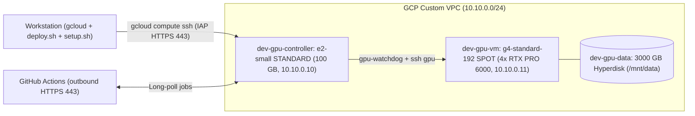

# `development/` — Cloud & On-Prem GPU Development Workflow

End-to-end automation and runbook for provisioning GPU development machines ([`scripts/deploy.sh`](./scripts/deploy.sh)) and configuring their persistent GitHub Actions self-hosted runner ([`scripts/setup.sh`](./scripts/setup.sh)) across **GCP**, **Azure**, and **on-premises** targets.

---

## Directory Layout

```text
development/
├── README.md                         # Complete step-by-step workflow & operations guide
├── gpu-dev-machine/                  # Podman + podman-compose stack (Ray Serve DeepSeek-V4.1-Flash, LiteLLM, DeepSeek Harness)
├── infra/
│   ├── gcp/                          # GCP Terraform: always-on Controller/Runner + Spot GPU VM + 3 TB Hyperdisk
│   ├── azure/                        # (Planned) Azure GPU VM Terraform
│   └── on-prem/                      # (Planned) On-prem GPU host configuration
└── scripts/
    ├── deploy.sh                     # Creates/manages the GPU machine infrastructure (--provider=<gcp|azure|on-prem>)
    ├── setup.sh                      # Configures/manages the GitHub Actions runner on the deployed machine
    └── deploy_gpu_stack.sh           # Syncs & deploys development/gpu-dev-machine via podman-compose (run by CI or locally)
```

---

## Architecture (`--provider=gcp`)



| Component | Default Spec | Lifecycle & Role |
| :--- | :--- | :--- |
| **Controller / Runner VM** (`dev-gpu-controller`) | `e2-small` (`STANDARD`), Ubuntu 24.04, `100 GB` `pd-balanced`, `10.10.0.10` | Runs 24/7. Hosts `gpu-watchdog.service` to restart the Spot GPU VM on preemption, plus the pre-staged GitHub Actions self-hosted runner (`github-runner` user + `/opt/actions-runner`). |
| **Development GPU VM** (`dev-gpu-vm`) | `g4-standard-192` (`SPOT`), 4× NVIDIA RTX PRO 6000, 192 vCPUs, 720 GB RAM, `10.10.0.11` | Preemptible (`instance_termination_action = "STOP"`). Retains boot disk, persistent Hyperdisk, and network identity across preemptions. |
| **Persistent Data Volume** (`dev-gpu-data`) | `3000 GB` `hyperdisk-balanced` | Formatted once (`ext4`) and auto-mounted at `/mnt/data` on every boot; survives Spot preemptions and VM restarts. |
| **IAM & Firewall** | Dedicated SAs (`dev-gpu-ctrl`, `dev-gpu-vm-sa`); **Public Ingress Disabled** | `dev-gpu-ctrl` has `compute.instanceAdmin.v1` and `compute.osAdminLogin` **only** on `dev-gpu-vm`. Direct public internet ingress is disabled; SSH tunnels over HTTPS via GCP IAP (`35.235.240.0/20`). |

---

## Step-by-Step Workflow

### Step 1 — Log In to `gcloud` & Select Active Project

`deploy.sh` uses your **currently logged-in `gcloud` credentials** and **active GCP project** directly—no service-account JSON keys or hardcoded project IDs are stored in the repository.

```bash
# Authenticate gcloud and select the target GCP project
gcloud auth login
gcloud config set project <YOUR_GCP_PROJECT_ID>

# Verify active account & project
gcloud config get-value account
gcloud config get-value project
```

---

### Step 2 — Preview Machine Deployment (`deploy.sh --dry-run`)

Always run `--dry-run` first to confirm the resolved `gcloud` account, active GCP project, target region (`europe-west4` by default), and exact Terraform commands without mutating anything:

```bash
./development/scripts/deploy.sh --provider=gcp --dry-run
```

---

### Step 3 — Create / Deploy the GPU Machine (`deploy.sh`)

Run [`deploy.sh`](./scripts/deploy.sh) to provision the Controller VM, persistent 3 TB Hyperdisk, and Spot GPU VM:

```bash
# Deploy in the default region (europe-west4, trying its GPU zones automatically)
./development/scripts/deploy.sh --provider=gcp

# Or automatically cycle across GPU-capable regions/zones until live Spot capacity is found
./development/scripts/deploy.sh --provider=gcp --cycle-regions

# Or cycle through a specific priority list of regions
./development/scripts/deploy.sh --provider=gcp --regions=europe-west4,europe-west1,us-central1,us-east4
```

**What `deploy.sh --provider=gcp` executes automatically:**
1. Mints a fresh OAuth token from your active `gcloud` session (`GOOGLE_OAUTH_ACCESS_TOKEN`) so Terraform uses your logged-in account instead of stale ADC files.
2. Enables `compute.googleapis.com`, `iap.googleapis.com`, `oslogin.googleapis.com`, and `iam.googleapis.com` on the active project, keeping public internet ingress disabled.
3. Runs `terraform init` and selects/creates a Terraform workspace named after the active GCP project.
4. Runs `terraform apply`:
   - If a zone has no immediate Spot stock (`ZONE_RESOURCE_POOL_EXHAUSTED`), tries the next candidate zone/region, or stages the `TERMINATED` GPU VM and binds IAM so `gpu-watchdog.service` on `dev-gpu-controller` automatically starts it as soon as Spot capacity returns.
   - During `dev-gpu-controller` boot (`controller_startup_script`), automatically configures fixed SSH host keys, starts `gpu-watchdog.service`, creates the `github-runner` user with GPU SSH keys (`/home/github-runner/.ssh/gpu_ed25519`), installs all runner OS/.NET packages (`curl`, `git`, `git-lfs`, `jq`, `libicu-dev`, `libkrb5-3`, `libssl-dev`, `rsync`, `tar`, `unzip`, `xz-utils`, `zip`, `zlib1g`), and unpacks the latest `actions-runner-linux-x64` release into `/opt/actions-runner`.
5. Exports gitignored SSH key artifacts (`ssh-key`, `ssh-key.pub`) into `development/infra/gcp/`.

---

### Step 4 — Connect & Manage the GPU Machine

#### From Your Workstation (via `gcloud` IAP)
Public internet ingress is disabled on GCP; `deploy.sh` prints the `gcloud compute ssh --tunnel-through-iap` commands at the end of deployment:

```bash
# Connect to the always-on Controller/Runner VM via IAP
eval "$(terraform -chdir=development/infra/gcp output -raw controller_ssh_command)"

# Connect directly to the Spot GPU VM via IAP
eval "$(terraform -chdir=development/infra/gcp output -raw gpu_ssh_command)"
```

#### Inside `dev-gpu-controller` (Watchdog & GPU Helpers)
Every user on `dev-gpu-controller` (including `dev`, OS Login users, and `github-runner`) has pre-configured passwordless SSH to `dev-gpu-vm` (`10.10.0.11`):

```bash
ssh gpu                       # Open an interactive shell on the GPU VM (10.10.0.11)
gpu-ssh 'nvidia-smi'          # Run a command on the GPU VM
gpu-wait-ssh 600              # Block up to 600s until GPU VM SSH is ready (e.g., during Spot restart)
rsync -az ./ gpu:/mnt/data/   # Sync datasets/code to the persistent 3 TB Hyperdisk

gpu-status                    # Check GPU VM state + gpu-watchdog.service logs
gpu-pause                     # Pause automatic Spot restarts (/etc/gpu-watchdog.paused)
gpu-resume                    # Resume automatic Spot restarts
```

---

### Step 5 — Set Up the GitHub Actions Runner (`setup.sh`)

[`setup.sh`](./scripts/setup.sh) connects to the deployed machine (`gcloud compute ssh --tunnel-through-iap` on GCP, or standard `ssh` on Azure/on-prem) and configures the persistent GitHub Actions runner service.

#### 5.1 Lock Down Public PRs First (Before Attaching the Runner)

If the target repository is **public**, lock down Pull Requests before registering the runner so external forks can never trigger `runs-on: self-hosted`:

1. **Disable Public PRs Completely (Simplest & Strongest):**
   - Go to **Settings → General → Features → Pull requests** and either **uncheck Pull requests** completely (hides the PR tab and blocks all PR creation) or **restrict pull request creation to collaborators only** (only users with write access can open PRs).
2. **Fork Workflow Approval Gate (if PRs stay enabled):**
   - Go to **Settings → Actions → General → Fork pull request workflows from outside collaborators** and select **"Require approval for all external contributors"** *(not "first-time contributors")*.
3. **Environment Gate (`Settings → Environments`):**
   - Create a `gpu` environment restricted to `Selected branches: main` and add yourself under **Required reviewers**.
4. **Workflow YAML (`on:` triggers — in code, not GitHub Settings):**
   - In any `.github/workflows/*.yml` that uses `runs-on: self-hosted`, trigger only on `workflow_dispatch` or `push: branches: [main]` (never `pull_request` or `pull_request_target`).

#### 5.2 Run `setup.sh` to Register & Start the Runner

1. In your GitHub repo, open **Settings → Actions → Runners → New self-hosted runner** and copy the setup token *(or use a Fine-Grained PAT via `--pat=<PAT>` with repo **Administration: Read & write**; if you omit `--token`/`--pat`, `setup.sh` prompts interactively without echoing to shell history)*.
2. Preview first with `--dry-run`, then run `setup.sh`:

```bash
# Preview runner registration
./development/scripts/setup.sh --provider=gcp --repo=vitorecomp/<YOUR_REPO> --dry-run

# Configure and start the persistent systemd runner service on the GCP Controller VM
./development/scripts/setup.sh --provider=gcp --repo=vitorecomp/<YOUR_REPO> --token=<TOKEN_FROM_REPO_SETTINGS>

# Check runner service status anytime
./development/scripts/setup.sh --provider=gcp --status
```

#### 5.3 Automated Stack Deployment Workflow ([`.github/workflows/deploy-gpu-machine.yml`](../.github/workflows/deploy-gpu-machine.yml))

Once the runner is online, pushes to `main` touching `development/gpu-dev-machine/**` (or manual `workflow_dispatch`) run [`deploy_gpu_stack.sh`](./scripts/deploy_gpu_stack.sh) on the selected self-hosted runner inside the protected `gpu` environment.

On GCP, the runner on `dev-gpu-controller` automatically runs `gpu-wait-ssh 600` (surviving Spot preemptions), bootstraps Podman + NVIDIA CDI + `/mnt/data` storage on `dev-gpu-vm` if missing, syncs `development/gpu-dev-machine/`, writes `.env` (`0600`) and the reverse-tunnel SSH key without echoing secrets, and runs `podman-compose -f compose.yml up -d --build`.

---

## GitHub Variables & Secrets Reference

### 1. Repository Variables (`Settings → Secrets and variables → Actions → Variables`)

> **Why Repository-level?** GitHub Actions resolves `runs-on:` before loading Environment variables, so runner selection lives in Repository Variables.

| Variable | Required | Default / Example | Description |
| :--- | :--- | :--- | :--- |
| **`GPU_RUNNER`** | **Recommended** | `gcp-gpu` *(or `azure-gpu`, `on-prem-gpu`)* | Controls which self-hosted runner pool executes `deploy-gpu-machine.yml` (`["self-hosted","linux","x64","<GPU_RUNNER>"]`). Matches the label registered by `setup.sh --provider=<provider>`. |
| **`GPU_RUNNER_LABELS`** | Optional | `["self-hosted","linux","x64","gcp-gpu"]` | Full JSON label array override for `runs-on:` if you need custom label combinations instead of `GPU_RUNNER`. |

### 2. `gpu` Environment Secrets (`Settings → Environments → gpu → Environment secrets`)

| Secret | Required | Description |
| :--- | :--- | :--- |
| **`LITELLM_MASTER_KEY`** | **Yes** | Master Bearer key securing the `litellm` proxy and injected into `deepseek-harness` (e.g. `sk-...`). |
| **`TUNNEL_SSH_PRIVATE_KEY`** | When tunnels enabled | OpenSSH private key (`id_ed25519`) used by `litellm-tunnel` and `deepseek-harness-tunnel` to reverse-SSH into `TUNNEL_SSH_HOST`. |
| **`HF_TOKEN`** | Optional | Hugging Face read token to avoid rate limits when downloading `deepseek-ai/DeepSeek-V4.1-Flash`. |
| **`GPU_SSH_PRIVATE_KEY`** | Optional (non-GCP) | SSH private key only when `GPU_TARGET_MODE=ssh` targets a remote `GPU_SSH_HOST` without `/etc/gpu-ssh/id_ed25519`. |

### 3. `gpu` Environment Variables (`Settings → Environments → gpu → Environment variables`)

> **Note:** Model, tensor-parallelism, and CPU-offload parameters are intentionally **not** pipeline variables—they are version-controlled directly in [`development/gpu-dev-machine/compose.yml`](./gpu-dev-machine/compose.yml).

| Variable | Required | Default | Description |
| :--- | :--- | :--- | :--- |
| **`ENABLE_REVERSE_TUNNELS`** | Optional | `true` if `TUNNEL_SSH_HOST` set, else `false` | Set `true` to start `litellm-tunnel` + `deepseek-harness-tunnel`, or `false` to run only `ray-server`, `litellm`, and `deepseek-harness`. |
| **`TUNNEL_SSH_HOST`** | When tunnels enabled | — | Remote bastion/machine hostname or IP receiving the reverse-forwarded ports. |
| **`TUNNEL_SSH_USER`** | When tunnels enabled | — | SSH username on `TUNNEL_SSH_HOST`. |
| **`TUNNEL_SSH_PORT`** | Optional | `22` | SSH port on `TUNNEL_SSH_HOST`. |
| **`TUNNEL_KNOWN_HOSTS`** | Optional | *(accept-new TOFU)* | Pinned `ssh-keyscan` line(s) for `TUNNEL_SSH_HOST` (enforces `StrictHostKeyChecking=yes`). |
| **`TUNNEL_BIND_ADDRESS`** | Optional | `127.0.0.1` | Interface bound on `TUNNEL_SSH_HOST` (`127.0.0.1` or `0.0.0.0`). |
| **`REMOTE_LITELLM_PORT`** | Optional | `4000` | Port opened on `TUNNEL_SSH_HOST` forwarding to `litellm:4000`. |
| **`REMOTE_HARNESS_PORT`** | Optional | `3080` | Port opened on `TUNNEL_SSH_HOST` forwarding to `deepseek-harness:3080`. |
| **`LITELLM_TUNNEL_SSH_HOST`** / `_PORT` / `_USER` | Optional | Inherits `TUNNEL_SSH_*` | Optional per-tunnel destination override for `litellm-tunnel`. |
| **`HARNESS_TUNNEL_SSH_HOST`** / `_PORT` / `_USER` | Optional | Inherits `TUNNEL_SSH_*` | Optional per-tunnel destination override for `deepseek-harness-tunnel`. |
| **`GPU_TARGET_MODE`** | Optional | `auto` | `auto` (`gpu-ssh` on GCP controller, `GPU_SSH_HOST` if set, else `local`), `controller-ssh`, `ssh`, or `local` (when runner lives directly on the GPU machine). |
| **`GPU_SSH_HOST`** / **`GPU_SSH_KNOWN_HOSTS`** | Optional | — | Target `user@host` and `known_hosts` when `GPU_TARGET_MODE=ssh`. |

---

### Step 6 — Day-2 Operations (Pause, Update, Destroy)

#### Pause GPU Billing While Preserving `/mnt/data` and the Runner
When you want zero GPU compute spend while keeping `dev-gpu-controller`, the GitHub runner, and the `3000 GB` `/mnt/data` Hyperdisk intact:

```bash
# 1. On dev-gpu-controller: pause the auto-restart watchdog
gpu-pause

# 2. Stop the GPU VM (from workstation or controller)
gcloud compute instances stop dev-gpu-vm --zone=europe-west4-a

# Later, resume automatic GPU VM startup:
gpu-resume
```

#### Plan / Update Infrastructure Changes
```bash
./development/scripts/deploy.sh --provider=gcp --plan
./development/scripts/deploy.sh --provider=gcp --apply
```

#### Remove Runner & Full Teardown (`--destroy`)
> **Warning:** `deploy.sh --destroy` deletes both VMs and the `dev-gpu-data` Hyperdisk volume (`3000 GB`). Back up `/mnt/data` before destroying.

```bash
# Optional: cleanly unregister the runner first
./development/scripts/setup.sh --provider=gcp --remove --token=<REMOVE_TOKEN_FROM_REPO_SETTINGS>

# Destroy all GCP GPU resources in the active project
./development/scripts/deploy.sh --provider=gcp --destroy
```

---

## CLI Reference

### 1. [`deploy.sh`](./scripts/deploy.sh) — Machine Creation & Infrastructure

| Flag | Description |
| :--- | :--- |
| `--provider=<gcp\|azure\|on-prem>` | **(Required)** Target infrastructure folder under `development/infra/<provider>`. |
| `--dry-run` | Print resolved credentials, active project, and Terraform commands without executing. |
| `--apply` | Initialize and apply Terraform (default action). |
| `--plan` | Initialize and run `terraform plan` without applying. |
| `--validate` | Run `terraform init -backend=false` and `terraform validate`. |
| `--destroy` | Destroy Terraform-managed resources for the selected provider. |
| `--project=<id>` | Override active `gcloud config` project (`gcp` only). |
| `--adc` | Use Application Default Credentials instead of logged-in `gcloud` access token (`gcp` only). |
| `--region=<region>` | Target cloud region override (default: `europe-west4`). |
| `--zone=<zone>` | Target cloud zone override (default: `europe-west4-a`, or all GPU zones in region on apply). |
| `--cycle-regions` | Cycle across all GPU-capable regions/zones until live Spot capacity is allocated (`gcp`). |
| `--regions=r1,r2,...` | Cycle through a specific comma-separated list of regions in order (`gcp`). |
| `--machine-type=<type>` | Override GPU VM machine type (default: `g4-standard-192`). |
| `--name-prefix=<prefix>` | Override resource prefix (default: `dev-gpu`). |
| `--no-stage-terminated` | Exit 1 instead of staging a `TERMINATED` Spot VM for `gpu-watchdog` if all zones lack capacity. |
| `--no-auto-approve` | Prompt interactively before `terraform apply` or `terraform destroy`. |

### 2. [`setup.sh`](./scripts/setup.sh) — GitHub Actions Runner Setup

| Flag | Description |
| :--- | :--- |
| `--provider=<gcp\|azure\|on-prem>` | Target provider (`gcp` connects via `gcloud compute ssh --tunnel-through-iap`; others via `ssh`). |
| `--host=<user@ip>` | Explicit SSH target override (or direct target for `on-prem` hosts). |
| `--repo=<owner/repo>` | GitHub repository to attach the persistent runner to (or `--url=https://github.com/...`). |
| `--token=<token>` | Runner token from Repo → Settings → Actions → Runners (or env `RUNNER_TOKEN`, or interactive prompt). |
| `--pat=<pat>` | Alternative: Fine-Grained PAT with repo Administration Read/Write (or env `RUNNER_PAT`). |
| `--name=<name>` | Runner name in GitHub (default: `<provider>-gpu-controller`). |
| `--labels=l1,l2,...` | Comma-separated runner labels (default: `self-hosted,linux,x64,<provider>-gpu`). |
| `--status` | Check the runner `systemd` service status on the remote machine. |
| `--remove` | Stop/uninstall the `systemd` unit and unregister the runner from GitHub. |
| `--dry-run` | Print resolved SSH target and remote runner setup commands without connecting. |
