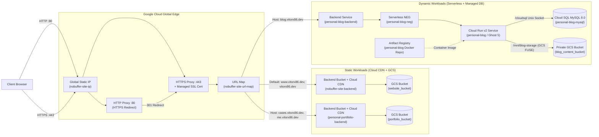

# Cloud Architecture

This document describes the Google Cloud Platform (GCP) and reverse-proxy architecture provisioned and managed under [`cloud/`](../cloud).

---

## 1. High-Level Topology

All public web properties under `vitorx86.dev` share a single **Global External Managed HTTPS Load Balancer**, a single **Global Anycast IPv4 address** (`nobuffer-site-ip`), and a single **Google-Managed SSL Certificate** (`nobuffer-site-cert-v2`). Traffic is routed by hostname (`host_rule`) to the appropriate backend:

---

## 2. Hosted Workloads

| Workload | Source Repo | Domains | Hosting Model | Backing Storage |
| :--- | :--- | :--- | :--- | :--- |
| **Main Website** (`nobuffer-site`) | `vitorecomp/nobuffer-site` | `www.vitorx86.dev`, `vitorx86.dev` | Cloud CDN + GCS Static Bucket | Public GCS Bucket (`website_bucket`) |
| **Personal Portfolio** (`personal-portifolio`) | `vitorecomp/personal-portifolio` | `cases.vitorx86.dev`, `me.vitorx86.dev` | Cloud CDN + GCS Static Bucket (Next.js/Nextra static export) | Public GCS Bucket (`portfolio_bucket`) |
| **Technology Blog** (`personal-blog`) | `vitorecomp/personal-blog` | `blog.vitorx86.dev` | Cloud Run v2 (`ghost:5-alpine` + `vitorx86-garage` theme) via Serverless NEG | Cloud SQL for MySQL 8.0 (`personal-blog-mysql`) + Private GCS Bucket (`blog_content_bucket`) |
| **Subdomain Reverse Proxy** | `personal-infra/cloud/nobuffer-site/reverse-proxy` | `demo.vitorx86.dev`, `homeapi.vitorx86.dev`, `maintance.vitorx86.dev` | Nginx + Certbot on Linux Server | Local container ports (`localhost:8081`) |

---

## 3. Component Breakdown

### 3.1 Shared Edge & Load Balancing ([`cloud/infra/modules/load-balancer/main.tf`](../cloud/infra/modules/load-balancer/main.tf))
- **Static IP (`google_compute_global_address.nobuffer_site_ip`)**: Single global IPv4 address used by all DNS `A` records for load-balanced domains.
- **HTTP-to-HTTPS Redirect**:
  - `google_compute_global_forwarding_rule.nobuffer_site_forwarding_rule` (Port `80`)
  - `google_compute_target_http_proxy.nobuffer_site_http_proxy`
  - `google_compute_url_map.nobuffer_site_redirect_map` (`https_redirect = true`, `strip_query = false`)
- **HTTPS Termination & Routing**:
  - `google_compute_global_forwarding_rule.nobuffer_site_forwarding_rule_https` (Port `443`, `EXTERNAL_MANAGED`)
  - `google_compute_managed_ssl_certificate.nobuffer_site_cert`: Automatically provisions and renews TLS certificates for the union of `var.domain`, `var.portfolio_domain`, and `var.blog_domain`.
  - `google_compute_url_map.nobuffer_site_url_map`:
    - **Default service**: Routes unmatched hosts (`www.vitorx86.dev`, `vitorx86.dev`) to `nobuffer_site_backend`.
    - **`portfolio-matcher`**: Routes `var.portfolio_domain` (`cases.vitorx86.dev`, `me.vitorx86.dev`) to `portfolio_backend`.
    - **`blog-matcher`**: Routes `var.blog_domain` (`blog.vitorx86.dev`) to `blog_backend` (Cloud Run Serverless NEG).

### 3.2 Static Website Backends (`nobuffer-site` & `personal-portifolio`)
- **GCS Buckets (`website_bucket`, `portfolio_bucket`)**:
  - Multi-region `US` location with `uniform_bucket_level_access = true`.
  - Configured with `main_page_suffix = "index.html"` and `not_found_page = "404.html"`.
  - Public read access granted via `roles/storage.objectViewer` for `allUsers`.
- **Cloud CDN (`nobuffer_site_backend`, `portfolio_backend`)**:
  - `CACHE_ALL_STATIC` mode with `client_ttl = 3600`, `default_ttl = 3600`, `max_ttl = 86400`, and `serve_while_stale = 86400`.
  - HTML entrypoints (`index.html`, `404.html`) are uploaded with `Cache-Control: no-cache` during Cloud Build so new deploys take effect immediately without serving stale asset hashes.

### 3.3 Dynamic Blog Backend (`personal-blog` on Cloud Run + Cloud SQL)
- **Artifact Registry (`google_artifact_registry_repository.blog_repo`)**:
  - Regional Docker repository (`personal-blog`) storing versioned Ghost 5 + `vitorx86-garage` images built by Cloud Build.
- **Cloud SQL for MySQL 8.0 (`google_sql_database_instance.blog_db`)**:
  - Managed MySQL 8.0 instance (`db-f1-micro` by default, `PD_SSD` with `disk_autoresize = true` and daily automated backups).
  - Dedicated `ghost` database (`utf8mb4` / `utf8mb4_0900_ai_ci`) and `ghost` MySQL user with a 32-character password managed by Terraform.
- **Cloud Run v2 Service (`google_cloud_run_v2_service.blog`)**:
  - Runs on `EXECUTION_ENVIRONMENT_GEN2` with `ingress = "INGRESS_TRAFFIC_INTERNAL_LOAD_BALANCER"` so traffic enters through the shared HTTPS Load Balancer.
  - Connects to Cloud SQL over the native Cloud SQL Auth Proxy Unix socket mounted at `/cloudsql/<connection_name>`.
  - Optionally mounts a private GCS bucket (`blog_content_bucket`) at `/mnt/blog-storage` via Cloud Storage FUSE to persist uploaded images and media across container restarts.

### 3.4 Nginx Subdomain Reverse Proxy ([`cloud/nobuffer-site/reverse-proxy/`](../cloud/nobuffer-site/reverse-proxy))
- Manages Nginx virtual host configs (`demo.vitorx86.dev`, `homeapi.vitorx86.dev`, `maintance.vitorx86.dev`) for self-hosted/VM container workloads, with automated TLS certificate issuance via Certbot.
