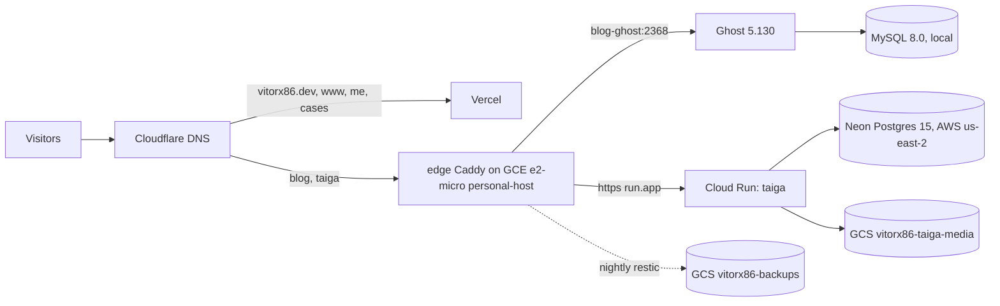

# Cloud Architecture

Everything is on free tiers except the VM's IPv4 address (~US$3.60/month). DNS for `vitorx86.dev` is on
**Cloudflare** (DNS-only records, managed by hand).

| Domain | Runs on | Code |
| :--- | :--- | :--- |
| `vitorx86.dev`, `www` | Vercel, Git integration on `vitorecomp/nobuffer-site` (static `build/`) | app repo `vercel.json` |
| `me.`, `cases.` | Vercel, Git integration on `vitorecomp/personal-portifolio` (static export `out/`) | app repo `vercel.json` |
| `blog.` | GCE e2-micro `personal-host` (`personal-project-514501`, us-central1): edge Caddy → Ghost → local MySQL | [`cloud/edge`](../cloud/edge), [`cloud/personal-blog`](../cloud/personal-blog) |
| `taiga.` | Cloud Run `taiga` (1 vCPU / 512 MiB, 0..1 instances), proxied by the edge Caddy; Neon database; uploads in GCS | [`cloud/taiga`](../cloud/taiga) |

## Components

- **VM `personal-host`** ([`cloud/infra/envs/gcp-taiga`](../cloud/infra/envs/gcp-taiga) → [`modules/gce-vm`](../cloud/infra/modules/gce-vm)):
  e2-micro + 30 GB pd-standard (free tier), dedicated VPC and firewall (22 for SSH deploys, 80/443), static IPv4
  `35.255.9.34`, 3 GB swap, Docker. Configured by [`bootstrap_vm.py`](../cloud/scripts/bootstrap_vm.py); runs the
  `edge` and `personal-blog` compose stacks. It builds nothing: images are built on GitHub runners, and Taiga is
  deployed to Cloud Run from GitHub Actions via Workload Identity Federation (`github-deployer`, no keys anywhere).
- **Edge Caddy** ([`cloud/edge`](../cloud/edge)): only container publishing 80/443; Let's Encrypt certificates
  (persisted in `edge_caddy-data`); per-site TLS mode in its `.env`.
- **Ghost** ([`cloud/personal-blog`](../cloud/personal-blog)): image from `vitorecomp/personal-blog`, built in CI and pulled from GHCR (digest-pinned);
  MySQL 8.0 tuned for 1 GB RAM; content volume `personal-blog_ghost-content`.
- **Taiga on Cloud Run** ([`cloud/taiga`](../cloud/taiga)): image in Artifact Registry (only the newest kept),
  `TAIGA_SECRET_KEY` / DB password in Secret Manager, uploads mounted from `gs://vitorx86-taiga-media`, migrations
  run from the GitHub runner at deploy time (instances skip them, so cold starts stay short). Taiga 6.10 needs Postgres ≤ 15.
- **Neon**: managed Postgres 15 (free plan; compute scales to zero, the container health check never touches it).
- **Backups** ([backup-restore.md](./backup-restore.md)): daily restic snapshots to `gs://vitorx86-backups`
  (blog MySQL + content; Taiga Neon dump + media bucket mirror + edge certificates).
- **Spare OCI VM** ([`cloud/infra/envs/oci-blog`](../cloud/infra/envs/oci-blog)): Always Free A1 in `sa-saopaulo-1`,
  compartment `vitorecomp`; no capacity yet, a retry loop (`oci-blog-retry.service` on the VM) keeps trying.
  OCI has a budget alert on any spend.

## Free-tier guardrails

| Service | Limit | How we stay inside |
| :--- | :--- | :--- |
| Compute Engine | 1 e2-micro, 30 GB pd-standard, us-central1 | `machine_type`/disk pinned in Terraform |
| Cloud Run | 180k vCPU-s, 360k GiB-s, 2M requests / month | 1 vCPU / 512 MiB, max 1 instance, request-based CPU, scale to zero |
| Artifact Registry | 0.5 GB | cleanup policy keeps 1 image (~250 MB) |
| Secret Manager | 6 active versions | 3 secrets, old versions destroyed on change |
| Cloud Storage | 5 GB in us-central1 | media + backups are a few MB |
| Network egress | 1 GB/month (Premium tier) | small personal traffic |
| Not free | VM external IPv4 | ~US$3.60/month (Google bills all in-use VM IPv4 beyond 1 h/month) |
