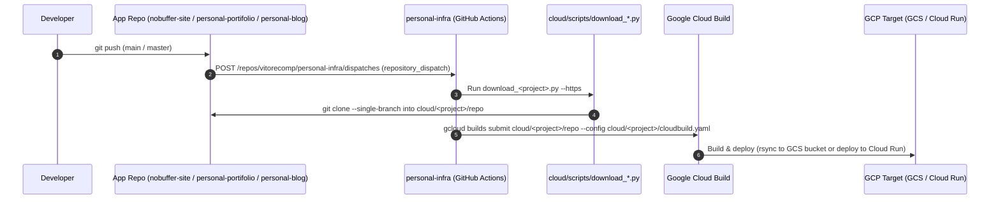

# Pipeline & CI/CD Setup

This document explains how continuous integration, infrastructure provisioning, and cross-repository deployments work in `personal-infra`.

---

## 1. End-to-End Deployment Flow

Application source code lives in its respective repository (`nobuffer-site`, `personal-portifolio`, `personal-blog`), while all Cloud Build pipelines, Terraform infrastructure, and deployment scripts are centralized in `personal-infra`.



---

## 2. GitHub Actions Workflows in `personal-infra`

| Workflow File | Triggers | Purpose |
| :--- | :--- | :--- |
| [`.github/workflows/ci.yml`](../.github/workflows/ci.yml) | `push`, `pull_request`, `workflow_dispatch` | Syntax-checks all Python scripts, runs `--dry-run` smoke tests for workspace and cloud scripts, and runs `terraform fmt -check` + `terraform validate`. |
| [`.github/workflows/terraform-cloud.yml`](../.github/workflows/terraform-cloud.yml) | `pull_request` / `push` on `cloud/infra/**`, `workflow_dispatch` | Runs `terraform plan` on PRs and `terraform apply` on pushes to `main`/`master` (or manual dispatch with `apply: true`). |
| [`.github/workflows/build-website.yml`](../.github/workflows/build-website.yml) | `push`, `workflow_dispatch`, `repository_dispatch` (`deploy-nobuffer-site`) | Clones `vitorecomp/nobuffer-site` and submits [`cloud/nobuffer-site/cloudbuild.yaml`](../cloud/nobuffer-site/cloudbuild.yaml) to publish static files to `gs://${GCS_BUCKET_NAME}`. |
| [`.github/workflows/build-portfolio.yml`](../.github/workflows/build-portfolio.yml) | `push`, `workflow_dispatch`, `repository_dispatch` (`deploy-personal-portifolio`) | Clones `vitorecomp/personal-portifolio` and submits [`cloud/personal-portifolio/cloudbuild.yaml`](../cloud/personal-portifolio/cloudbuild.yaml) to export Next.js/Nextra static HTML and sync to `gs://${GCS_PORTFOLIO_BUCKET_NAME}`. |
| [`.github/workflows/build-blog.yml`](../.github/workflows/build-blog.yml) | `push`, `workflow_dispatch`, `repository_dispatch` (`deploy-personal-blog`) | Clones `vitorecomp/personal-blog` and submits [`cloud/personal-blog/cloudbuild.yaml`](../cloud/personal-blog/cloudbuild.yaml) to validate the Ghost theme, push the image to Artifact Registry, and deploy to Cloud Run. |
| [`.github/workflows/deploy-nginx-sites.yml`](../.github/workflows/deploy-nginx-sites.yml) | `push` on `cloud/nobuffer-site/reverse-proxy/**`, `workflow_dispatch` | Copies Nginx vhost files to the server over SCP/SSH, validates with `nginx -t`, reloads Nginx, and ensures Certbot certificates. |
| [`.github/workflows/update-repo-stats.yml`](../.github/workflows/update-repo-stats.yml) | Weekly cron (`0 6 * * 1`), `workflow_dispatch` | Runs [`update_repo_stats.py`](../workspace/scripts/update_repo_stats.py) and commits updated metadata (sorted by `last updated`) to [`repo_stats.csv`](../workspace/documentation/repo_stats.csv). |

---

## 3. Required GitHub Secrets & Variables

### 3.1 In `vitorecomp/personal-infra`

#### Repository Secrets (`Settings -> Secrets and variables -> Actions -> Secrets`)

| Secret Name | Required By | Description |
| :--- | :--- | :--- |
| `GCP_SA_KEY` | `terraform-cloud.yml`, `build-website.yml`, `build-portfolio.yml`, `build-blog.yml` | Service Account JSON key with permissions for Cloud Build, GCS, Cloud Run, Cloud SQL, Artifact Registry, and Compute Load Balancing. |
| `BLOG_ADMIN_PASSWORD` | `terraform-cloud.yml` | Initial Ghost Admin Owner password seeded automatically on Cloud Run startup. |
| `BLOG_DB_PASSWORD` | `terraform-cloud.yml` _(optional)_ | Password for the Ghost Cloud SQL MySQL user (`ghost`). If omitted, Terraform generates a 32-character random password automatically. |
| `HOST` | `deploy-nginx-sites.yml` | Target SSH hostname or IP address for Nginx reverse-proxy deployment. |
| `USERNAME` | `deploy-nginx-sites.yml` | SSH username for the Nginx server. |
| `KEY` | `deploy-nginx-sites.yml` | Private SSH key for the Nginx server. |
| `METRICS_TOKEN` | `update-repo-stats.yml` _(optional)_ | GitHub Personal Access Token to include private repo metadata and raise API rate limits (falls back to `GITHUB_TOKEN`). |

#### Repository Variables (`Settings -> Secrets and variables -> Actions -> Variables`)

| Variable Name | Default / Example | Description |
| :--- | :--- | :--- |
| `GCP_PROJECT_ID` | `my-gcp-project-id` | Google Cloud Project ID used by Terraform. |
| `GCP_REGION` | `us-central1` | Region for Cloud Run, Cloud SQL, and Artifact Registry. |
| `GCS_BUCKET_NAME` | `vitorx86-nobuffer-site-prod` | Target GCS bucket for `nobuffer-site`. |
| `GCS_PORTFOLIO_BUCKET_NAME` | `vitorx86-portfolio-prod` | Target GCS bucket for `personal-portifolio`. |
| `GCS_BLOG_CONTENT_BUCKET_NAME` | `vitorx86-blog-content-prod` _(optional)_ | Private GCS bucket mounted into Cloud Run for Ghost media persistence. |
| `NOBUFFER_DOMAINS` | `["www.vitorx86.dev","vitorx86.dev"]` | JSON list of domains routed to `nobuffer-site`. |
| `PORTFOLIO_DOMAINS` | `["cases.vitorx86.dev","me.vitorx86.dev"]` | JSON list of domains routed to `personal-portifolio`. |
| `BLOG_DOMAINS` | `["blog.vitorx86.dev"]` | JSON list of domains routed to `personal-blog`. |
| `GAR_BLOG_REPO` | `personal-blog` | Artifact Registry Docker repository name for `personal-blog`. |
| `CLOUD_RUN_BLOG_SERVICE` | `personal-blog` | Cloud Run service name for `personal-blog`. |
| `BLOG_URL` | `https://blog.vitorx86.dev` | Public canonical URL passed to Ghost (`url` env var). |
| `BLOG_ADMIN_EMAIL` | `vitor.ecomp@gmail.com` | Initial Ghost Admin Owner email address seeded on startup. |

---

### 3.2 In `nobuffer-site`, `personal-portifolio`, and `personal-blog`

Each application repository contains `.github/workflows/trigger-deploy.yml`, which triggers the corresponding build workflow in `vitorecomp/personal-infra` via `repository_dispatch`:

| Secret Name | Target Repos | Description |
| :--- | :--- | :--- |
| `PERSONAL_INFRA_TOKEN` _(or `METRICS_TOKEN`)_ | `nobuffer-site`, `personal-portifolio`, `personal-blog` | Fine-grained GitHub PAT with **Contents: Read and write** on `vitorecomp/personal-infra` so `gh api repos/vitorecomp/personal-infra/dispatches` can trigger deployments. |

---

## 4. Local CLI Deployment Reference

All cloud deployments can also be previewed (`--dry-run`) or executed directly from a developer machine using the zero-dependency Python scripts in [`cloud/scripts/`](../cloud/scripts):

```bash
# 1. Preview commands without making changes (--dry-run)
python3 cloud/scripts/download_nobuffer_site.py --deploy --bucket <nobuffer_bucket> --dry-run
python3 cloud/scripts/download_personal_portifolio.py --deploy --bucket <portfolio_bucket> --dry-run
python3 cloud/scripts/download_personal_blog.py --deploy --dry-run

# 2. Download/update source repositories only (into cloud/<project>/repo)
python3 cloud/scripts/download_nobuffer_site.py
python3 cloud/scripts/download_personal_portifolio.py
python3 cloud/scripts/download_personal_blog.py

# 3. Download/update and submit to Google Cloud Build
python3 cloud/scripts/download_nobuffer_site.py --deploy --bucket <nobuffer_bucket>
python3 cloud/scripts/download_personal_portifolio.py --deploy --bucket <portfolio_bucket>
python3 cloud/scripts/download_personal_blog.py --deploy --region us-central1
```
